# The rig's flows, by PoC objective

How the rig proves each objective in *Agentic IDAM - Trust Controller PoC Objectives* (10 July 2026): a brief description,
the checks that prove it, and the flow as a sequence diagram. Two things produce the evidence:

- **the control centre**: the agent marketplace (`marketplace/`, http://localhost:3000). It deploys Principal versions,
  suspends and reinstates them, and runs scenarios as them.
- **the harness**: `spire-workload/harness.py`, whose checks are mapped to objectives in `spire-workload/objectives.py`.

The marketplace's Objectives page shows the current evidence for each objective. The objectives the rig cannot show by
running something are listed under [Documentary objectives](#documentary-objectives).

The parties, as named in the diagrams:

| Name | What it is |
|---|---|
| Operator | the person at the marketplace, signed in to Raidiam |
| Marketplace | the Agent registry and control centre (`marketplace/`) |
| Raidiam | the Trust Controller: the CBA federation's authority and trust anchor, and its admin API |
| Provider | the agent provider (`entity-host`, behind Kong on 8443): it hosts the agents' Entity Configurations and holds their keys |
| SPIRE | SPIRE server and agent: workload registration and attestation |
| Agent | a Principal agent instance (`agent.py`), e.g. `principal-1` |
| PingFed | PingFederate with the OpenID Federation modules: the token endpoint, the co-hosted attester, the SSF transmitter |
| Gateway | Kong with the coaz-pep plugin, in front of every resource and every agent other agents call |
| PDP | PingAuthorize |
| Resource | rs-accounts or rs-payments (MCP) |
| SubAgent | the Accounts or Payments agent (`sub_agent.py`) |

---

## TC-01 Marketplace registration triggers the Agent Identity workflow

**What it shows:** approving a Principal version in the marketplace starts the whole identity workflow. That covers the
statement, the certificates, the roles, its publication and its workload registration, with no step done by hand.

**Proved by:** the marketplace's *deploy* action, whose log records each step against Raidiam's API.

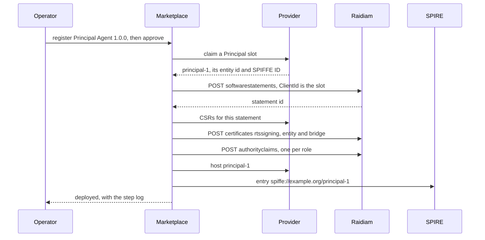

## TC-02 The Trust Controller governs approval, suspension and withdrawal

**What it shows:** the agent's standing is Raidiam's. Approval is a statement Raidiam vouches for. Suspension sets that
statement `Suspended`, after which Raidiam's authority stops issuing a subordinate statement for it, and every party that
resolves trust through Raidiam refuses the agent.

**Proved by:** the marketplace's *suspend* and *reinstate* actions, the *while suspended* scenario, and the harness's
`Raidiam vouches for the agent's entity key` check.

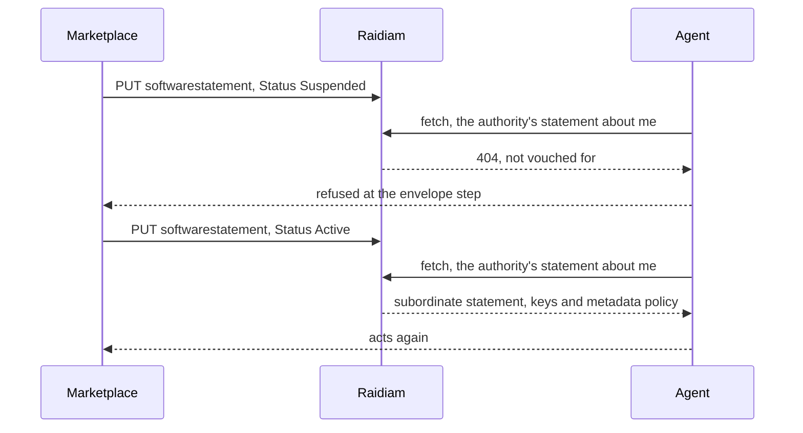

## TC-03 Token flow with an Agent Identity trust check before access

**What it shows:** before an agent touches a resource it is attested, its trust chain is resolved and checked, and it
gets a token for that resource bound to its instance key. The gateway, the PDP and the resource then each check the token
and the agent before the call is allowed.

**Proved by:** the *acts as itself* scenario, and the harness's `run` and `gateway` stages.

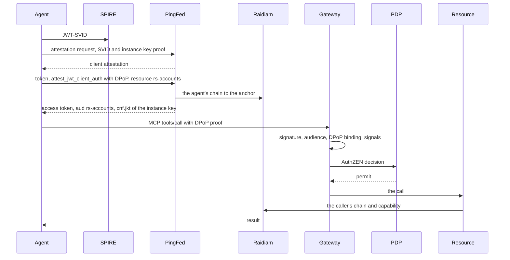

## TC-04 A lifecycle event revokes or disables the Agent Identity

**What it shows:** a suspension takes effect within seconds, not when a token expires. Shared Signals events from
PingFederate's transmitter reach the gateway, which refuses existing tokens (`session-revoked`) or every token
(`account-disabled`). A single instance can be disabled by its key thumbprint while the agent's other instances carry on.

**Proved by:** the harness's `signals` stage, the *Payments agent disabled* check in the `a2a` stage, and the
marketplace's *suspend* action, which raises `account-disabled`.

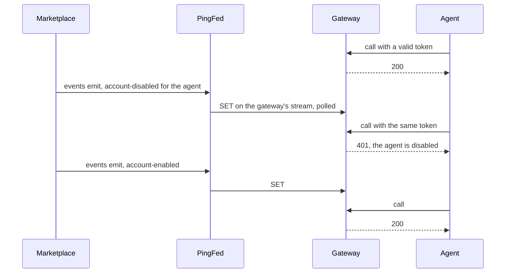

## TC-05 Publishing, updating and withdrawing Entity Configurations

**What it shows:** each agent's identity is a standard OpenID Federation Entity Configuration, published by its provider.
Deploying a version publishes it, suspending withdraws it, and reinstating publishes it again.

**Proved by:** the harness's `the provider serves the agent's Entity Configuration` check, and the marketplace's
deploy, suspend and reinstate actions.

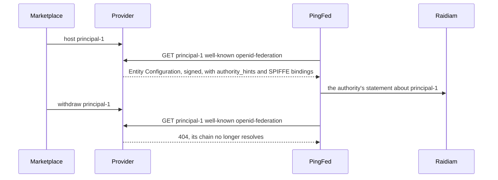

## TC-06 The marketplace as Agent registry, separate from identity and trust

**What it shows:** the marketplace holds the catalogue record: owner, version, evidence and lifecycle state. Raidiam holds
the identity. The two are joined by the software statement ID, never copied.

**Proved by:** the marketplace's *deploy* action. The record keeps `softwareStatementId` and reads Raidiam back rather
than storing its own copy.

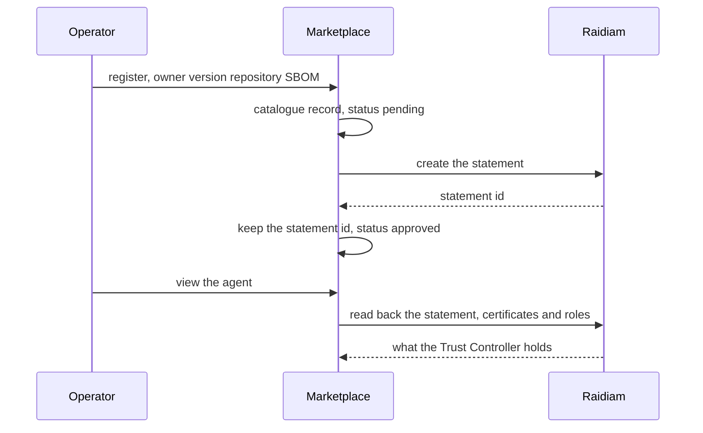

## TC-07 Orchestration across agent workflow events and identity workflows

**What it shows:** one marketplace event drives many systems in order: provider, Raidiam, SPIRE and PingFederate. The
deploy waits for the downstream result (Raidiam vouching, PingFederate registering) and resumes where it stopped if a
step fails.

**Proved by:** the marketplace's *deploy* action, and its resumption after a refused step.

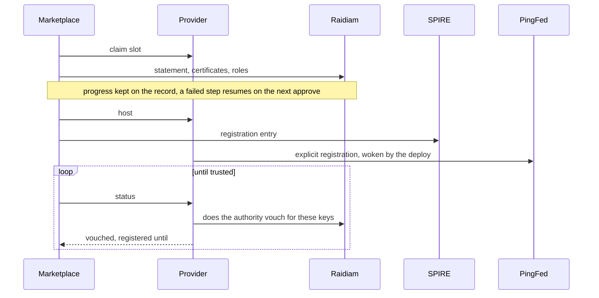

## TC-08 Policy enforcement for trust decisions

**What it shows:** decisions come from the federation and from policy, not from the client. The capability envelope comes
from the agent's Raidiam roles, and PingAuthorize decides each call on the action and its context. The rig's policy
permits reads and payments, and denies a payment over 1000.

**Proved by:** the *outside its envelope* and *over the policy limit* scenarios, and the harness's
`the PDP permits` / `the PDP denies` checks.

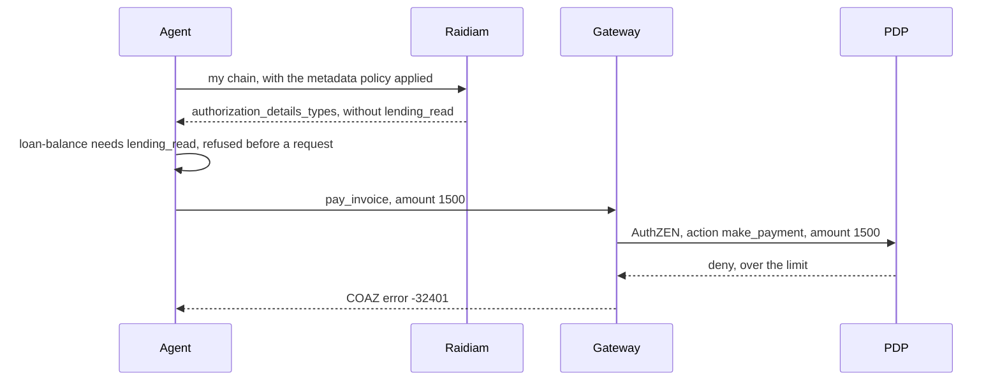

## TC-09 Federation bridge for an existing authorisation server

**What it shows:** PingFederate, an existing enterprise authorisation server, joins the federation without being rebuilt.
It resolves chains, applies Raidiam's metadata policy, registers clients from them, and publishes its own Entity
Configuration under Raidiam's authority.

**Proved by:** the harness's `PingFederate answers`, `the agent is registered at PingFederate`,
`Raidiam vouches for PingFederate` and `token for this agent, for the resource` checks.

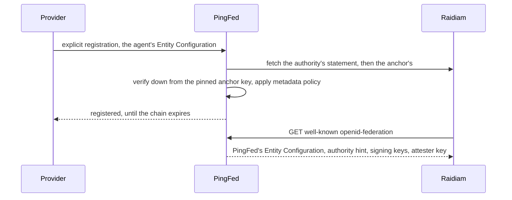

## TC-10 The Trust Controller as authoritative source

**What it shows:** every party takes what an agent is and may do from Raidiam, not from local configuration. That covers
PingFederate when it registers the client, the agent when it reads its own envelope, the agents finding each other by
capability, and the resource when it checks the caller.

**Proved by:** the harness's `found the resource through the federation`, `found through the federation by capability`
and `acted for the Principal` checks, and the *agents act on its behalf* scenario.

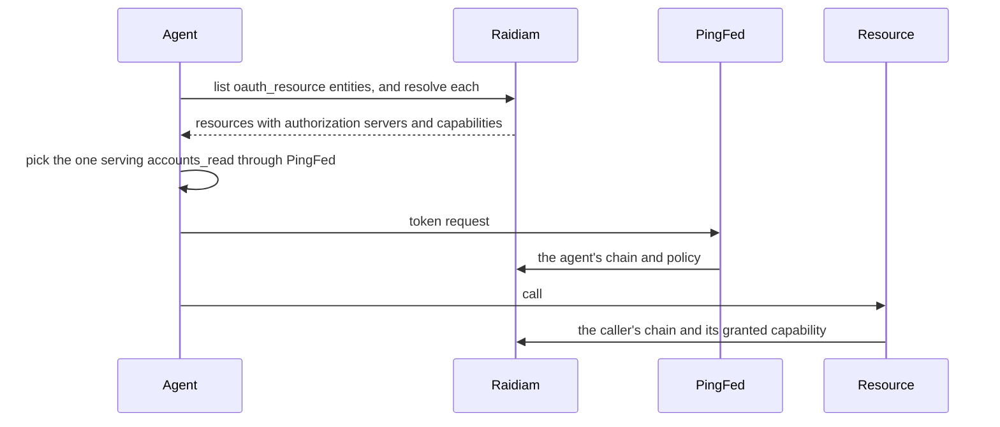

## TC-11 The OpenID Federation target state

**What it shows:** standard OpenID Federation throughout: Entity Configurations, subordinate statements, metadata policy
and trust chains to a pinned anchor. Attesters are trusted the same way, with no static shortcuts. The deviations are
explicit: explicit registration, local chain resolution inside the protected network, and `act` as a string.

**Proved by:** the harness's `PingFederate publishes its attester key` and
`PingFederate trusts no static attesters` checks, and the Entity Configuration checks.

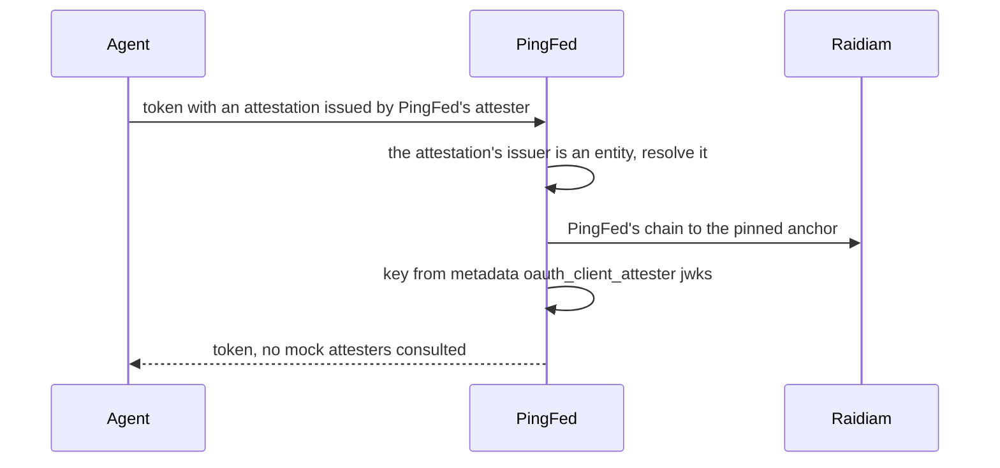

## TC-12 Overlay compatibility with the enterprise authorisation server landscape

**What it shows:** the federation overlays existing infrastructure. PingFederate issues the tokens, and attestation is
pluggable: PingFederate's own attester or the agent provider's, each trusted the same way through its chain.

**Proved by:** the *attested by the provider instead* scenario, and the harness's `attesters` stage
(`the same job attested by the provider instead is trusted too`).

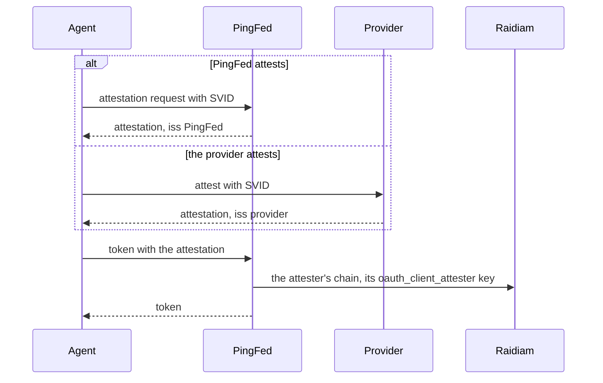

## TC-14 Identity and authentication controls

**What it shows:** no anonymous or bearer-only access. Tokens are sender-constrained to the instance key with DPoP: a
token presented as a bearer, a proof from another key or a replayed proof is refused. Only PingFederate's signatures are
honoured, and each hop of a delegated call has its own bound token.

**Proved by:** the harness's `DPoP` checks, `refuses a call with no token`, `not signed by PingFederate`, and
`bound to its own instance key` in the `a2a` stage.

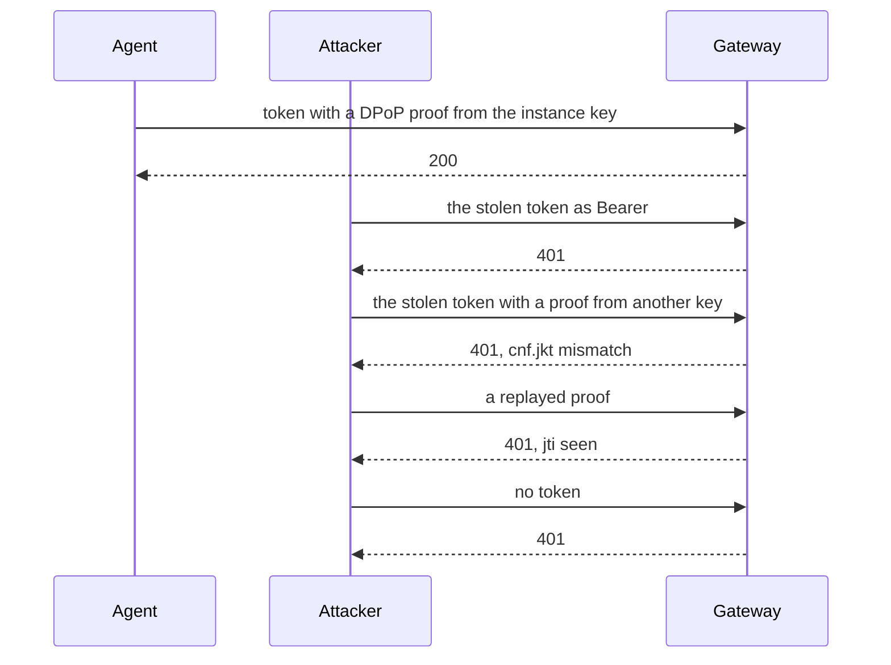

## TC-15 Secure configuration and hardening

**What it shows:** partly evidenced. Trust shortcuts are gone: no mock attesters, and every attester is trusted through
the federation. The rig's remaining development shortcuts are listed in `raidiam/PROTECTED-ENVIRONMENTS.md` (section 13),
each with its production equivalent.

**Proved by:** the harness's `PingFederate trusts no static attesters` check. The flow is TC-11's.

## TC-18 Security logging of trust decisions

**What it shows:** every decision at the gateway is logged with its principal and its reason: permits, PDP denials,
refusals (token, DPoP, signal) and signals received. Everything can be traced to a run.

**Proved by:** the harness's `decisions are logged at the gateway with principal and reason` check.

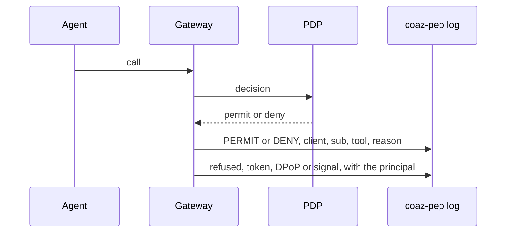

## TC-19 Observability and monitoring

**What it shows:** the components' state and every step of a flow can be seen. The harness's preflight checks every
service, each agent run emits a structured `AGENT_RESULT`, and the marketplace shows each deploy's step log, each version's
live status (provider, Raidiam, PingFederate) and each scenario's run.

**Proved by:** the harness's `is running` checks and the decision log. The marketplace's agent page shows it live.

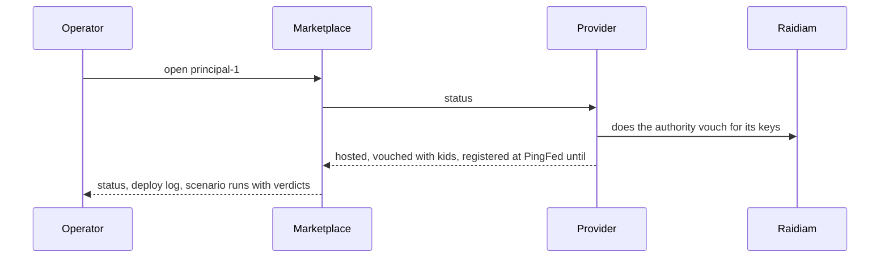

## TC-21 Recoverability and rebuild

**What it shows:** the environment rebuilds from code. `up.sh` recreates PingFederate from its archive and configuration,
compose recreates the rest, and the agents re-register by themselves. The marketplace keeps its Raidiam session and deploy
progress across restarts.

**Proved by:** the harness's `is running` checks after a rebuild.

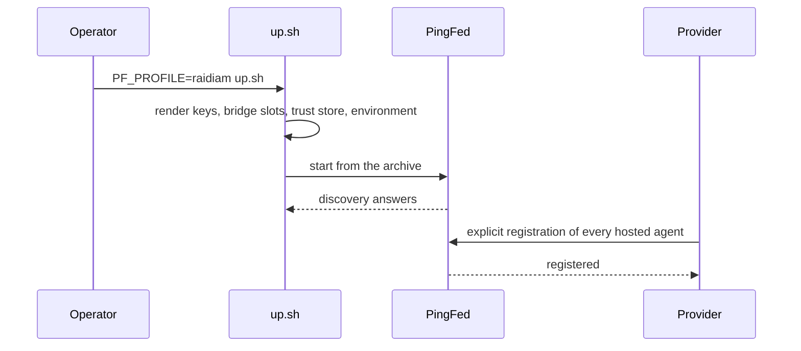

## TC-25 Agent Identity metadata and external evidence

**What it shows:** partly evidenced. The catalogue holds the agent's evidence (owner, repository, SBOM) and Raidiam's
statement references it in `AdditionalSoftwareMetadata` (SPIFFE ID, trust domain, version, catalogue ID). The provider's
Entity Configuration publishes the agents' SPIFFE bindings. Wiring a full manifest is still open.

**Proved by:** the marketplace's *deploy* action, and the harness's `the provider binds the agents' SPIFFE IDs` check.

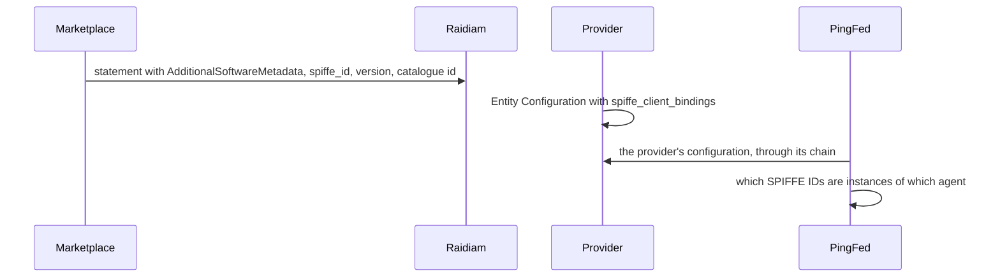

## TC-26 Cryptographic assurance with no private-key custody in the Trust Controller

**What it shows:** Raidiam certifies public keys and never holds a private one. The provider makes every key, sends only
CSRs, and signs with its own keys under the kids Raidiam publishes. Each instance's key never leaves its container.

**Proved by:** the marketplace's *deploy* action (CSRs only), the harness's `Raidiam vouches for the agent's entity key`
and `attested by` checks.

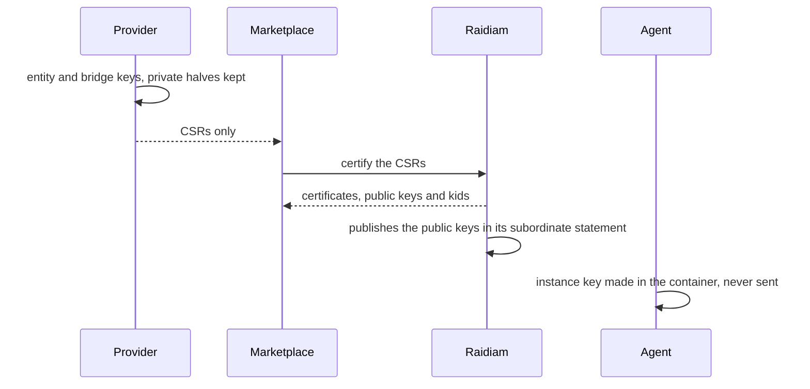

## TC-27 A governed, versioned capability envelope

**What it shows:** what an agent may do is governed by Raidiam roles, which become `authorization_details_types` through
metadata policy. The envelope is consumed by the agent itself, by the resource, and through delegation: each agent in a
chain is checked, so a capability can't be passed through another agent.

**Proved by:** the harness's `is in the envelope`, `a job outside the envelope` and `checked both agents` checks, and the
*outside its envelope* scenario.

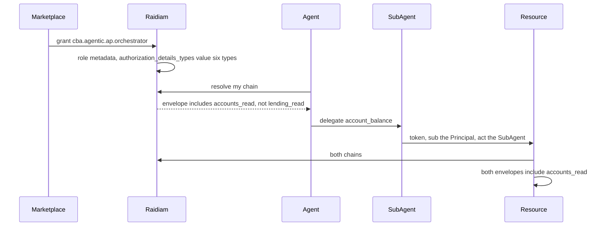

## TC-28 Automated workload registration and SPIFFE/SPIRE attestation

**What it shows:** the workload identity is registered by the deploy, not by hand. Attestation rests on what SPIRE says
the container is, never on what the agent claims. A container SPIRE identifies as another workload gets no attestation as
the agent, and one instance can be withdrawn by its key.

**Proved by:** the marketplace's *deploy* action (SPIRE entry), the *another workload claims to be it* scenario, and the
harness's `spire` stage, `SPIRE identified the container` and `attested as this agent` checks.

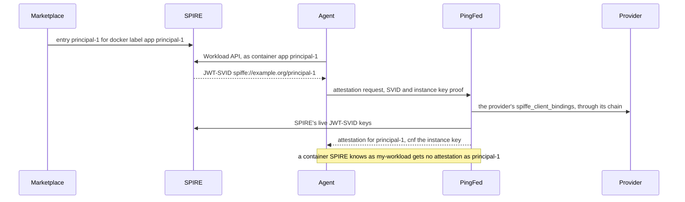

---

## Documentary objectives

These objectives are about decisions, documents or operations, not anything the rig can run:

| Objective | Where it is covered |
|---|---|
| TC-13 Deployment model options and CBA boundary implications | `raidiam/PROTECTED-ENVIRONMENTS.md`: the outbound-only model, where Raidiam lists and vouches but cannot resolve |
| TC-16 Vulnerability identification and remediation | vulnerability management, documentary |
| TC-17 Network protection, segmentation and isolation | network design, documentary; the rig runs on one Docker network |
| TC-20 Data protection and recovery | data protection and backup, documentary |
| TC-22 Support, operating model and vendor enablement | documentary |
| TC-23 Commercial and procurement implications | documentary |
| TC-24 Implementation gaps and internal build effort | the gap registers in the READMEs: explicit registration, `act` as a string, bridge-key slots, the operator session for Raidiam's admin API |
