# The rig's flows, by PoC objective

How the rig proves each objective in *Agentic IDAM - Trust Controller PoC Objectives* (10 July 2026): a brief description,
the checks that prove it, and the flow as a sequence diagram. Two things produce the evidence:

- **the control centre**: the agent marketplace (`marketplace/`, http://localhost:3000). It deploys Principal versions,
  suspends and reinstates them, and runs scenarios as them.
- **the harness**: `spire-workload/harness.py`, whose checks are mapped to objectives in `spire-workload/objectives.py`.

The marketplace's Objectives page shows the current evidence for each objective. The objectives the rig cannot show by
running something are listed under [Documentary objectives](#documentary-objectives).

The parties, as named in the diagrams:

| Name | What it is | What it does | Why it is necessary |
|---|---|---|---|
| Operator | The person running the demo: an agent owner or approver, signed in to Raidiam through the marketplace | Registers, approves, suspends and reinstates agents, and runs scenarios | Agent identities are governed, not self-asserted. Someone accountable decides an agent may exist and act (TC-01, TC-02) |
| Marketplace | The Agent registry and control centre (`marketplace/`, Node) | Holds the catalogue record (owner, version, evidence, lifecycle). On approval it drives the identity workflow: the statement, its SPIFFE binding, certificate and roles in Raidiam, the bridge key in the KMS (its enrolment token), the SPIRE entry. It runs scenarios and shows the objectives' evidence | Keeps the business record of an agent separate from its identity (TC-06), and orchestrates the identity workflow from a registry event (TC-01, TC-07) |
| Raidiam | The Trust Controller: the CBA federation's authority and trust anchor, with its admin API and directory | Holds software statements, certified public keys and roles. It hosts and signs each Principal version's Entity Configuration (a federation-managed statement), publishes signed subordinate statements with keys and metadata policy (the capability envelope and the SPIFFE binding), lists entities, and stops vouching when a statement is suspended | The single authoritative source of who an agent is and what it may do (TC-10). Every party trusts an agent only through a chain to its pinned anchor, never through local configuration |
| SPIRE | The SPIRE server and agent: the workload identity system (SPIFFE) | Attests running containers by their properties (Docker labels) and issues JWT-SVIDs, e.g. `spiffe://example.org/agent-3f2c9a1e` for a Principal version (`agent-` and the first eight characters of its statement id). Its OIDC provider (`spire-oidc`) serves the trust domain's live keys | Ties an agent identity to the workload actually running it, from evidence the workload cannot forge (TC-28). Without it, anything holding a key could claim to be the agent |
| Agent | A Principal agent instance (`agent.py`): a version the marketplace deployed, which Raidiam hosts, running in its own container under its workload label | Gets itself attested, reads its own envelope from Raidiam, finds resources and other agents through the federation, gets DPoP-bound tokens, and calls resources or delegates to sub-agents | The subject of the PoC: an autonomous workload acting on its own identity, or on someone's behalf, under the bank's controls |
| PingFed | PingFederate with the OpenID Federation modules: the bank's existing authorisation server | Resolves and validates trust chains. Its co-hosted attester reads every agent's SPIFFE binding from Raidiam and attests instances on SPIRE's evidence. Its token endpoint (`attest_jwt_client_auth` + DPoP, token exchange) registers an agent it does not have from its chain once its attestation verifies, issues tokens, and signs each attested agent's bridge assertion in the KMS. Its SSF transmitter emits lifecycle events | Shows that the enterprise authorisation server can join the federation as it is (TC-09, TC-12). It issues every token, so trust decisions are enforced where credentials are minted |
| KMS | OpenBao's transit engine (`openbao`, `RAIDIAM_BRIDGE_BACKING=vault`; Principal versions need it), standing in for the bank's KMS or HSM | Holds each agent's bridge key, never exported. It creates a key when the marketplace enrols an agent, makes and signs its CSR for Raidiam to certify, and signs PingFederate's bridge assertion for the agent at each attested token request. PingFederate's token may only sign, the marketplace's enrolment token only create keys and get their CSRs | PingFederate can only authenticate an attested agent through a `private_key_jwt` signed with a key of that agent's. Held here, no bridge private key sits in a file or in PingFederate's configuration (TC-26), and keys found by name mean agents are enrolled with no limit and no restart |
| Gateway | Kong with the coaz-pep plugin, in front of every resource and every agent other agents call | Verifies the token (signature, audience, expiry), the DPoP proof and replay, and the Shared Signals state. It asks the PDP per call and logs every decision | Puts enforcement in the network path rather than in each resource (TC-03, TC-14, TC-18), and makes lifecycle events take effect in seconds (TC-04) |
| PDP | PingAuthorize, through its AuthZEN interface; its policy is authored through the PAP API | Decides each call on the action, its arguments and its context, e.g. permits reads, denies payments over 1000 | Separates policy from code: business rules on what an agent may do change without redeploying anything (TC-08) |
| Resource | rs-accounts and rs-payments: MCP servers inside the protected network, federation entities of their own | Serve the banking tools (balances, payments). They check the token again, and the caller's (and on-behalf-of party's) chain and capability in Raidiam | The protected assets the controls exist for. Their federation identity lets agents find them by capability (TC-10) |
| SubAgent | The Accounts and Payments agents (`sub_agent.py`): both a client and a resource, each serving its own Entity Configuration and resource metadata at its identifier, through Kong on 8443 | Accept calls from the Principal, exchange its token (RFC 8693, `sub` the Principal, `act` themselves) and call their resource with a token bound to their own instance | Prove agents calling agents: delegation is explicit and checked at every hop, so no capability passes through an agent that lacks it (TC-27) |
| Attacker | Anyone holding a stolen token or proof (TC-14's diagram only) | Replays tokens and proofs, or presents them from another key | Shows that sender-constrained tokens are useless to anyone but the attested instance |
| coaz-pep log | The gateway PEP's decision log (TC-18's diagram only) | Records each permit, deny, refusal and signal with the principal and the reason | The audit trail for trust decisions (TC-18, TC-19) |
| up.sh | The rig's build and start script (TC-21's diagram only) | Renders keys, the bridge-key file, the trust store and the environment, and starts PingFederate from its archive | Proves the environment rebuilds from code (TC-21) |

---

## TC-01 Marketplace registration triggers the Agent Identity workflow

**What it shows:** approving a Principal version in the marketplace starts the whole identity workflow, with no step done
by hand:
- the statement in Raidiam, a federation-managed entity: Raidiam hosts and signs the version's Entity Configuration at
  `https://rp.directory.cba.raidiam.io/openid_relying_party/<statement id>`;
- its SPIFFE binding on the statement (`AdditionalSoftwareMetadata`), its certificate and its roles in Raidiam;
- its bridge key, `bridge-<statement id>`, created in the KMS (OpenBao), which makes and signs its CSR. Versions are
  enrolled by name, so there is no limit and PingFederate needs no restart;
- its workload registration in SPIRE, under the label `agent-<first 8 characters of the statement id>`.

Nobody registers the version at PingFederate: PingFederate registers it from Raidiam at its first attested token request.

**Proved by:** the marketplace's *deploy* action, whose log records each step against Raidiam's API and the KMS.

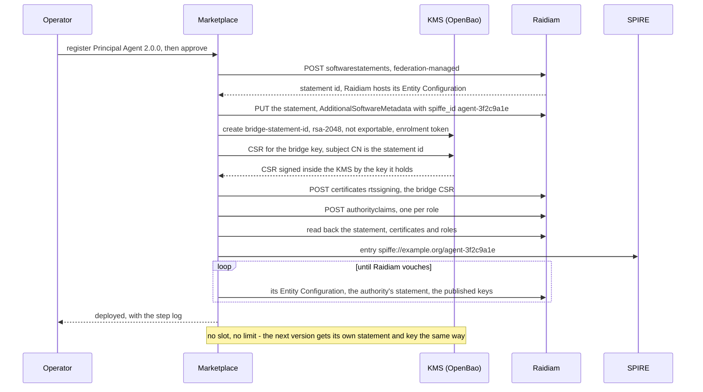

## TC-02 The Trust Controller governs approval, suspension and withdrawal

**What it shows:** the agent's standing is Raidiam's. Approval is a statement Raidiam vouches for. Suspension sets that
statement `Suspended`, after which Raidiam's authority stops issuing a subordinate statement for it, and every party that
resolves trust through Raidiam refuses the agent.

**Proved by:** the marketplace's *suspend* and *reinstate* actions, the *while suspended* scenario, and the harness's
`Raidiam vouches for the agent and publishes its bridge key` check.

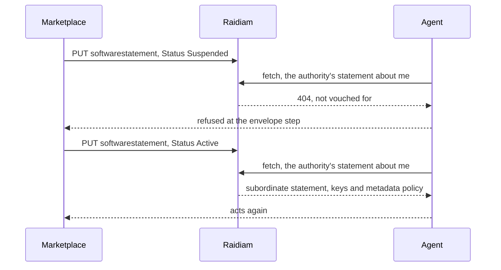

## TC-03 Token flow with an Agent Identity trust check before access

**What it shows:** before an agent touches a resource it is attested, its trust chain is resolved and checked, and it
gets a token for that resource bound to its instance key. The gateway, the PDP and the resource then each check the token
and the agent before the call is allowed.

**Proved by:** the *acts as itself* scenario, and the harness's `run` and `gateway` stages.

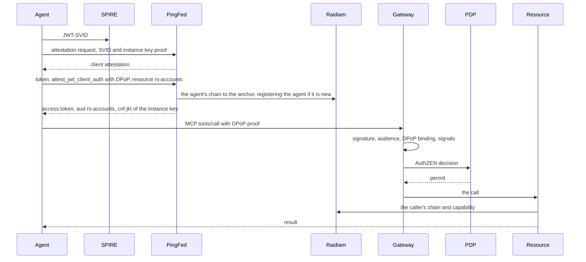

## TC-04 A lifecycle event revokes or disables the Agent Identity

**What it shows:** a suspension takes effect within seconds, not when a token expires. Shared Signals events from
PingFederate's transmitter reach the gateway, which refuses existing tokens (`session-revoked`) or every token
(`account-disabled`). A single instance can be disabled by its key thumbprint while the agent's other instances carry on.

**Proved by:** the harness's `signals` stage, the *Payments agent disabled* check in the `a2a` stage, and the
marketplace's *suspend* action, which raises `account-disabled`.

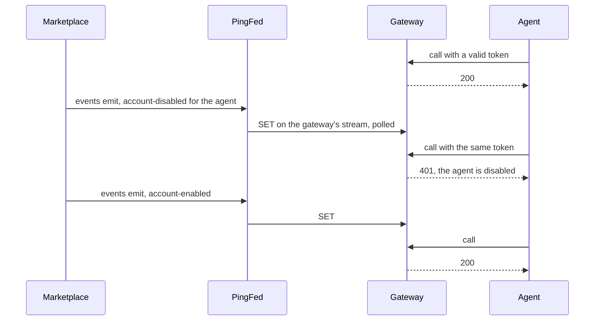

## TC-05 Publishing, updating and withdrawing Entity Configurations

**What it shows:** each agent's identity is a standard OpenID Federation Entity Configuration. A Principal version's is
hosted and signed by Raidiam itself, from a federation-managed statement: deploying the version publishes it, suspending
the statement makes Raidiam's authority stop vouching for it, so its chain no longer resolves, and reinstating restores
it. The sub-agents, which other agents call, serve their own at their identifiers.

**Proved by:** the harness's `Raidiam hosts the agent's Entity Configuration` and
`the accounts-agent serves its own Entity Configuration` (and the payments-agent's) checks, and the marketplace's
deploy, suspend and reinstate actions.

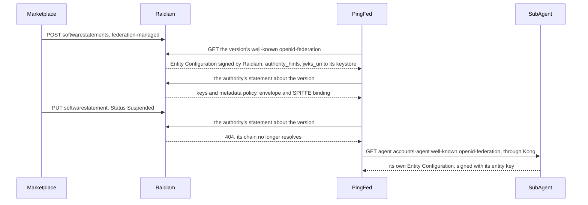

## TC-06 The marketplace as Agent registry, separate from identity and trust

**What it shows:** the marketplace holds the catalogue record: owner, version, evidence and lifecycle state. Raidiam holds
the identity. The two are joined by the software statement ID, never copied.

**Proved by:** the marketplace's *deploy* action. The record keeps `softwareStatementId` and reads Raidiam back rather
than storing its own copy.

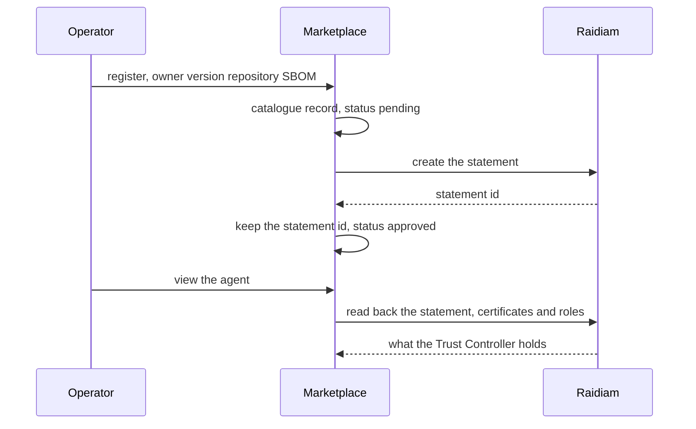

## TC-07 Orchestration across agent workflow events and identity workflows

**What it shows:** one marketplace event drives many systems in order: Raidiam, the KMS and SPIRE. The deploy waits for
the downstream result (Raidiam serving the version's Entity Configuration and vouching for it, with its bridge key) and
resumes where it stopped if a step fails. PingFederate needs no step: it registers the version from Raidiam at its first
attested token request, which the version's status then shows.

**Proved by:** the marketplace's *deploy* action, and its resumption after a refused step.

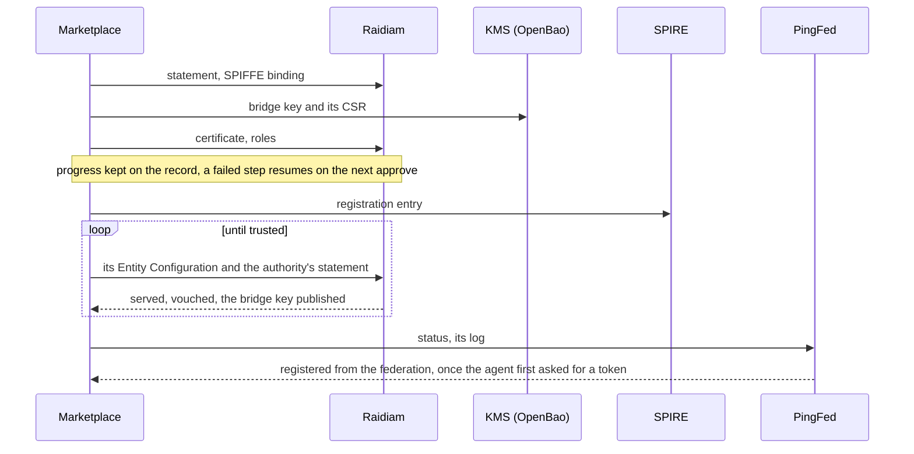

## TC-08 Policy enforcement for trust decisions

**What it shows:** decisions come from the federation and from policy, not from the client. The capability envelope comes
from the agent's Raidiam roles, and PingAuthorize decides each call on the action and its context. The rig's policy
permits reads and payments, and denies a payment over 1000.

**Proved by:** the *outside its envelope* and *over the policy limit* scenarios, and the harness's
`the PDP permits` / `the PDP denies` checks.

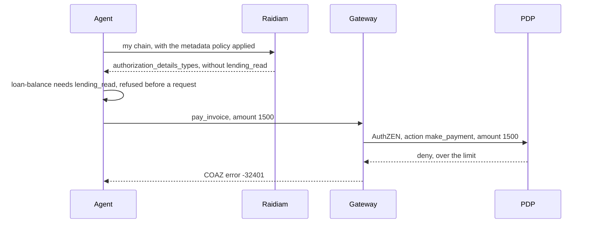

## TC-09 Federation bridge for an existing authorisation server

**What it shows:** PingFederate, an existing enterprise authorisation server, joins the federation without being rebuilt.
It resolves chains, applies Raidiam's metadata policy, registers clients from them, and publishes its own Entity
Configuration under Raidiam's authority. Nobody registers an agent beforehand: once an agent's attestation verifies at
the token endpoint, PingFederate registers a client it does not have by discovery through its trust chain
(`OIDF_ATTESTATION_AUTO_REGISTRATION=true`). A request that is not authenticated triggers no discovery.

**Proved by:** the harness's `PingFederate answers`,
`PingFederate registered the agent from Raidiam on its verified attestation`, `Raidiam vouches for PingFederate` and
`token for this agent, for the resource` checks.

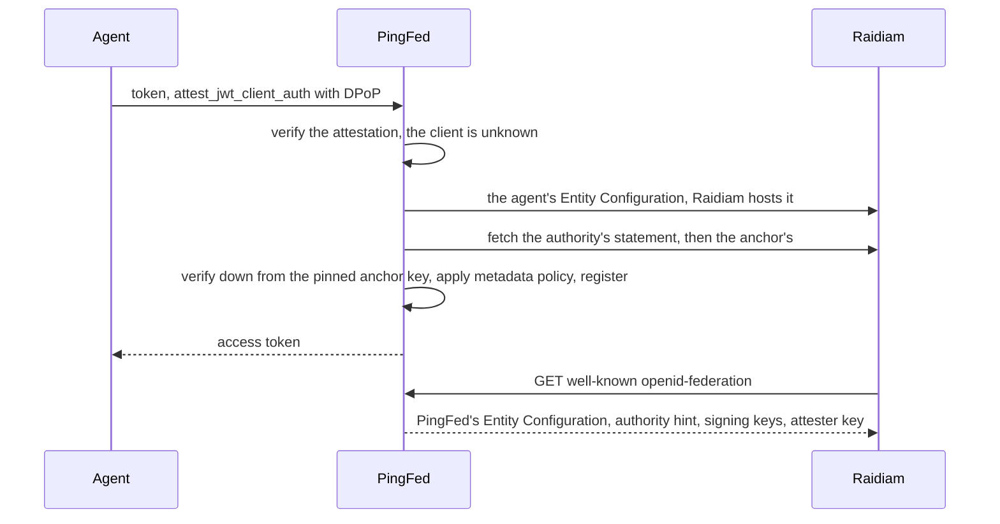

## TC-10 The Trust Controller as authoritative source

**What it shows:** every party takes what an agent is and may do from Raidiam, not from local configuration. That covers
PingFederate when it registers the client, the agent when it reads its own envelope, the agents finding each other by
capability, and the resource when it checks the caller.

**Proved by:** the harness's `found the resource through the federation`, `found through the federation by capability`
and `acted for the Principal` checks, and the *agents act on its behalf* scenario.

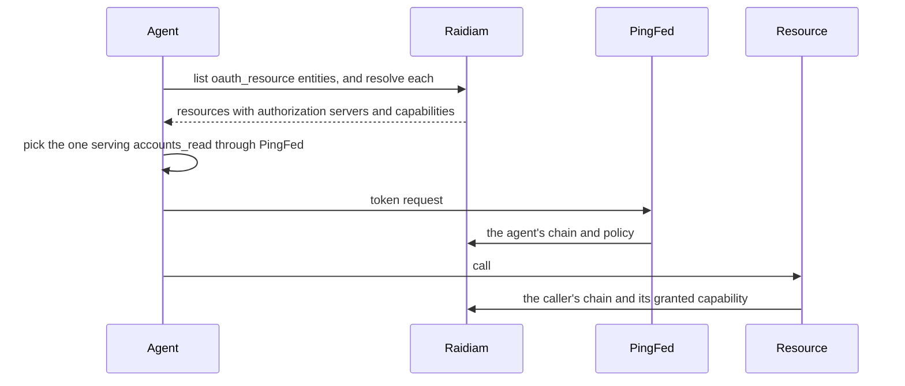

## TC-11 The OpenID Federation target state

**What it shows:** standard OpenID Federation throughout: Entity Configurations, subordinate statements, metadata policy
and trust chains to a pinned anchor, with agents registered by discovery through their chains. Attesters are trusted the
same way, with no static shortcuts. The deviations are explicit: registration triggered by a verified client
attestation, local chain resolution inside the protected network, and `act` as a string.

**Proved by:** the harness's `PingFederate publishes its attester key` and
`PingFederate trusts no static attesters` checks, and the Entity Configuration checks.

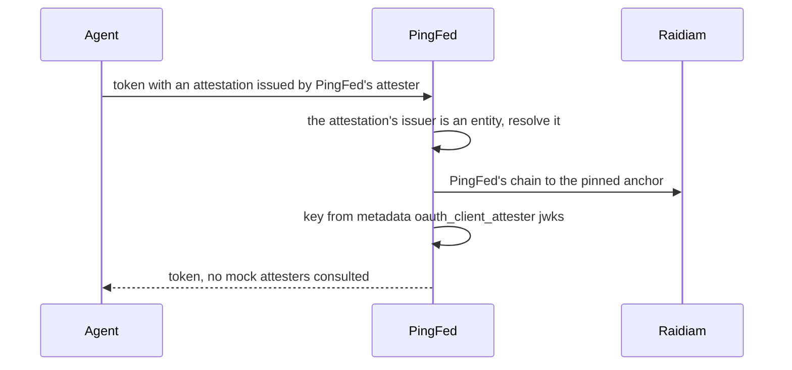

## TC-12 Overlay compatibility with the enterprise authorisation server landscape

**What it shows:** the federation overlays existing infrastructure. PingFederate issues the tokens, and its co-hosted
attester is a federation entity like any other: it takes the agents' SPIFFE bindings from Raidiam's authority, and its
attestations are trusted through PingFederate's chain, so any authorisation server in the federation could verify them.
Nothing is configured in PingFederate per agent.

**Proved by:** the harness's `PingFederate answers`,
`PingFederate's attester reads the bindings from Raidiam (openid-federation-authority)` and
`Raidiam vouches for PingFederate, so its attester's key resolves through the federation` checks.

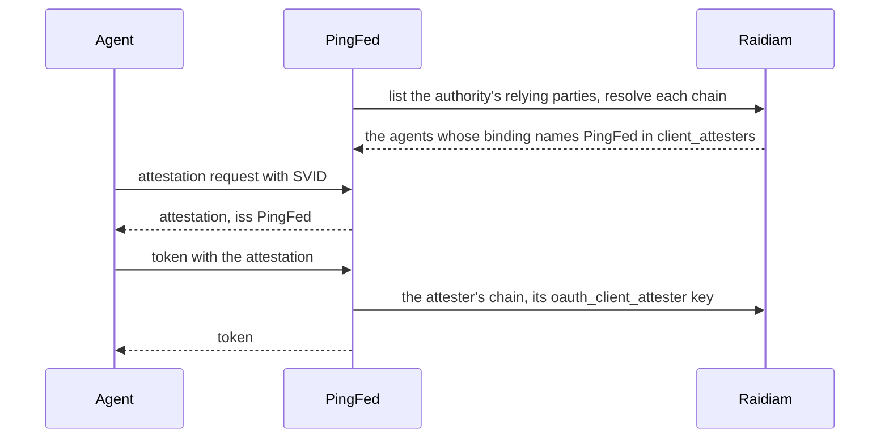

## TC-14 Identity and authentication controls

**What it shows:** no anonymous or bearer-only access. Tokens are sender-constrained to the instance key with DPoP: a
token presented as a bearer, a proof from another key or a replayed proof is refused. Only PingFederate's signatures are
honoured, and each hop of a delegated call has its own bound token.

**Proved by:** the harness's `DPoP` checks, `refuses a call with no token`, `not signed by PingFederate`, and
`bound to its own instance key` in the `a2a` stage.

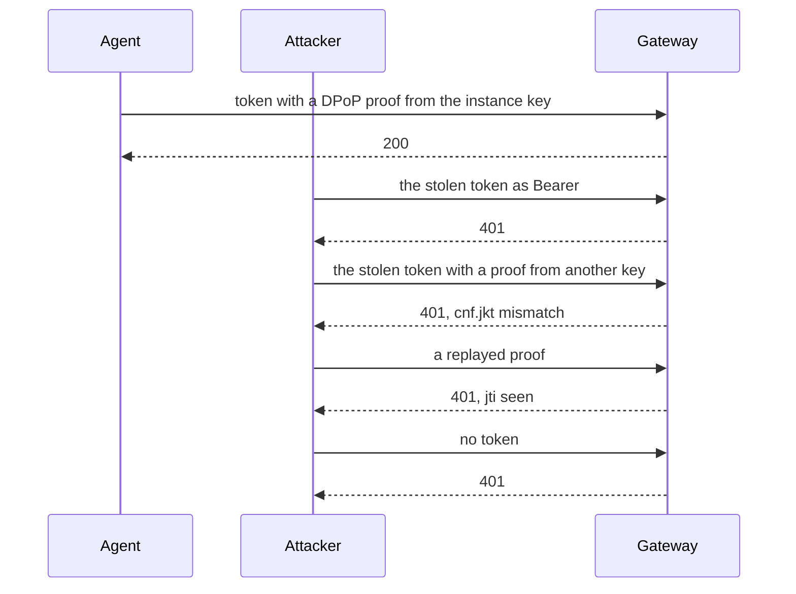

## TC-15 Secure configuration and hardening

**What it shows:** partly evidenced. Trust shortcuts are gone: no mock attesters, and every attester is trusted through
the federation. The rig's remaining development shortcuts are listed in `raidiam/PROTECTED-ENVIRONMENTS.md` (section 13),
each with its production equivalent.

**Proved by:** the harness's `PingFederate trusts no static attesters` check. The flow is TC-11's.

## TC-18 Security logging of trust decisions

**What it shows:** every decision at the gateway is logged with its principal and its reason: permits, PDP denials,
refusals (token, DPoP, signal) and signals received. Everything can be traced to a run.

**Proved by:** the harness's `decisions are logged at the gateway with principal and reason` check.

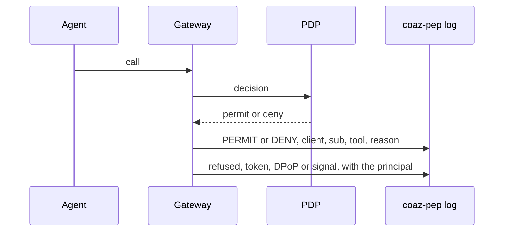

## TC-19 Observability and monitoring

**What it shows:** the components' state and every step of a flow can be seen. The harness's preflight checks every
service, each agent run emits a structured `AGENT_RESULT`, and the marketplace shows each deploy's step log, each version's
live status (Raidiam, PingFederate) and each scenario's run.

**Proved by:** the harness's `is running` checks and the decision log. The marketplace's agent page shows it live.

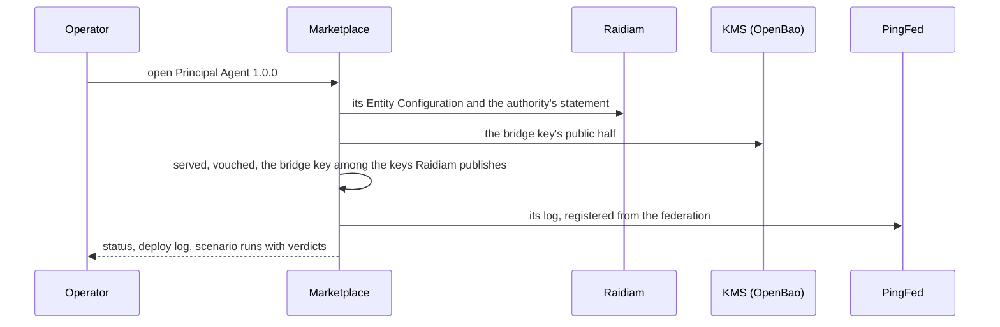

## TC-21 Recoverability and rebuild

**What it shows:** the environment rebuilds from code. `up.sh` recreates PingFederate from its archive and configuration,
compose recreates the rest. A restart of PingFederate drops its registrations, and it registers each agent again from
Raidiam at the agent's next attested token request. The marketplace keeps its Raidiam session and deploy progress across
restarts, and the bridge keys stay in the KMS.

**Proved by:** the harness's `is running` checks after a rebuild.

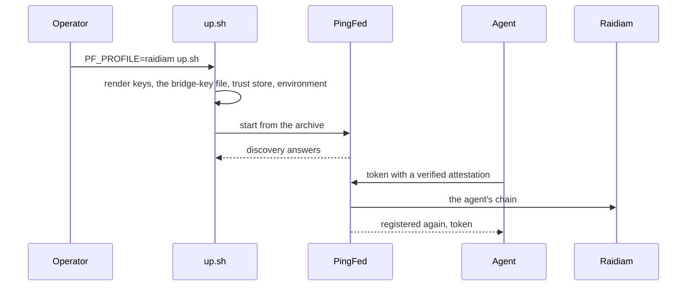

## TC-25 Agent Identity metadata and external evidence

**What it shows:** partly evidenced. The catalogue holds the agent's evidence (owner, repository, SBOM) and Raidiam's
statement carries the agent's SPIFFE binding in `AdditionalSoftwareMetadata` (`spiffe_id`, `spiffe_trust_domain`,
`spiffe_bundle_endpoint`, `client_attesters`), which its authority publishes as value policies. Raidiam keeps at most
255 characters there, so the binding is all it carries. Wiring a full manifest is still open.

**Proved by:** the marketplace's *deploy* action, and the harness's
`Raidiam binds the agent's SPIFFE ID for PingFederate's attester` check.

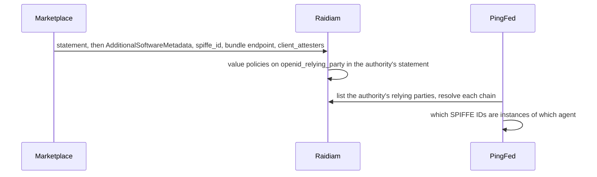

## TC-26 Cryptographic assurance with no private-key custody in the Trust Controller

**What it shows:** Raidiam certifies public keys and never holds a private one of the agent's. Each private key stays
with whoever needs it:
- **A Principal version has no entity key.** Raidiam hosts its Entity Configuration and signs it with Raidiam's own
  keys, as it does for every federation-managed statement.
- **The KMS (OpenBao)** creates the agent's bridge key, the one PingFederate authenticates the agent with, and keeps it.
  It is never exported, and the KMS signs both its CSR and every bridge assertion. No bridge private key sits in a
  file or in PingFederate's configuration.
- **Each sub-agent** keeps its own entity key, which signs its own Entity Configuration.
- **Each instance's key** never leaves its container.

The KMS gives each party one right: PingFederate may only sign with bridge keys, and the marketplace, with its enrolment
token, may only create them and get their CSRs.

**Proved by:**
- the marketplace's *deploy* action (a CSR only);
- the check that Raidiam's published bridge key is the KMS's key;
- the harness's `Raidiam vouches for the agent and publishes its bridge key` and `attested by` checks;
- every attested token in the harness, its bridge assertion signed in the KMS.

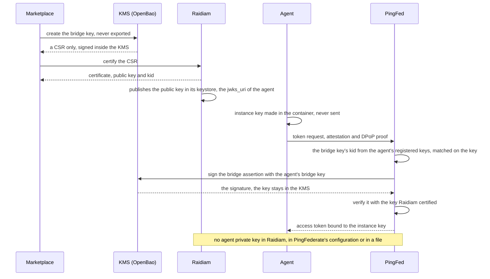

## TC-27 A governed, versioned capability envelope

**What it shows:** what an agent may do is governed by Raidiam roles, which become `authorization_details_types` through
metadata policy. The envelope is consumed by the agent itself, by the resource, and through delegation: each agent in a
chain is checked, so a capability can't be passed through another agent.

**Proved by:** the harness's `is in the envelope`, `a job outside the envelope` and `checked both agents` checks, and the
*outside its envelope* scenario.

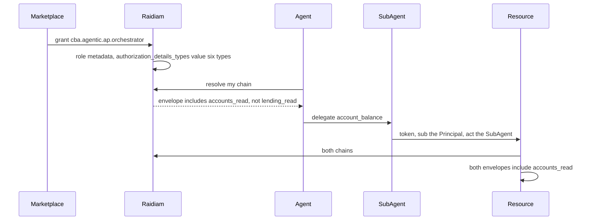

## TC-28 Automated workload registration and SPIFFE/SPIRE attestation

**What it shows:** the workload identity is registered by the deploy, not by hand. Attestation rests on what SPIRE says
the container is, never on what the agent claims. A container SPIRE identifies as another workload gets no attestation as
the agent, and one instance can be withdrawn by its key.

Which SPIFFE ID is which agent is Raidiam's word. Each agent's statement carries its binding in
AdditionalSoftwareMetadata (`spiffe_id`, `spiffe_trust_domain`, `spiffe_bundle_endpoint`, `client_attesters`), and
Raidiam's authority publishes it as value policies on `openid_relying_party`. PingFederate's attester
(`OIDF_ATTESTER_FEDERATION_AUTHORITY`, resolver `openid-federation-authority`) lists the authority's relying parties,
resolves each chain to the pinned anchor, and takes as clients those whose binding names it in `client_attesters`; what
an agent says of itself is overridden. A Principal version's SPIFFE ID is `spiffe://example.org/agent-` and the first
eight characters of its statement id, and its SPIRE entry selects the same label.

**Proved by:** the marketplace's *deploy* action (SPIRE entry, the statement's SPIFFE metadata), the *another workload
claims to be it* scenario, and the harness's `spire` stage, `Raidiam binds the agent's SPIFFE ID for PingFederate's
attester`, `SPIRE identified the container` and `attested as this agent` checks.

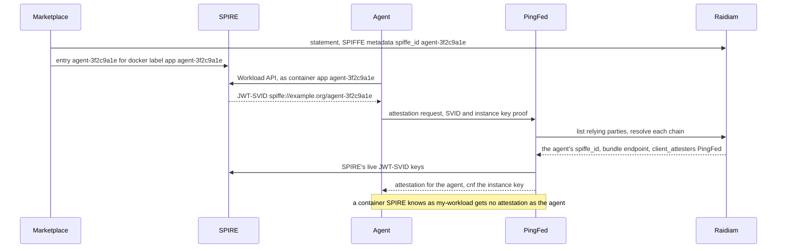

---

## Without an agent provider

### Why the rig had one

The rig first followed CBA's own agentic pattern (`provider.demo.cba.raidiam.io`, agent-r): agents hosted by an **agent
provider**, a federation entity Raidiam vouched for (`entity-host` here). It existed for three reasons:
- **It mirrored the architecture CBA was evaluating**, in which third parties host agents.
- **Raidiam could not carry what attestation needs.** Its federation-managed entities lacked `authority_hints`, and it
  did not publish per-statement metadata such as SPIFFE bindings, so the binding of a workload to an agent had to live
  in an Entity Configuration the rig controlled.
- **The private keys stayed with the agents' owner** (TC-26): the provider made the CSRs and signed with keys the Trust
  Controller never held.

Raidiam now does both things it lacked: its federation-managed Entity Configurations carry `authority_hints` and resolve
through the authority, and it publishes a statement's `AdditionalSoftwareMetadata` as value policies. PingFederate's
modules now register an attested agent themselves. So the rig runs without a provider.

### What replaced each of its jobs

| The provider's job | Now |
|---|---|
| Hosting and signing the Principals' Entity Configurations | **Raidiam**: each Principal version is a federation-managed statement (`openid_entity_federation_managed`). Raidiam serves and signs its Entity Configuration at `https://rp.directory.cba.raidiam.io/openid_relying_party/<statement id>`, with `client_registration_types` `automatic` and a `jwks_uri` pointing at Raidiam's keystore of the certificates it issued |
| Hosting the sub-agents' Entity Configurations | **Each sub-agent** serves its own, and its resource metadata, at its identifier, through Kong on 8443 (`gateway-agents`) |
| Holding the agents' entity keys and making their CSRs | A Principal has **no entity key**: Raidiam signs its configuration. Each sub-agent keeps its own (`keys/raidiam/agents/<name>/`) |
| Publishing the SPIFFE bindings (`spiffe_client_bindings`) | **Raidiam**: the binding is on the statement (`AdditionalSoftwareMetadata`), published by its authority as value policies, and read from there by PingFederate's attester (`OIDF_ATTESTER_FEDERATION_AUTHORITY`) |
| Enrolling each agent's bridge key in the KMS | **The marketplace**, with OpenBao's enrolment token: it creates `bridge-<statement id>`, and the vault makes and signs its CSR |
| Registering the agents at PingFederate, and again before each registration ended | **PingFederate** itself, at the agent's first attested token request (`OIDF_ATTESTATION_AUTO_REGISTRATION=true`) |
| Attesting instances (`/attest`) | **PingFederate's co-hosted attester** only |
| Withdrawing a suspended agent's Entity Configuration | **Raidiam's status** (`Suspended`: the authority stops vouching) and a Shared Signals `account-disabled` |
| Reporting a version's status to the marketplace | **The marketplace** asks Raidiam (served, vouched, the bridge key published) and PingFederate's log (registered) |
| The edge on 8443 | **`gateway-agents`**: the sub-agents' identities and MCP, and `/cb` for the marketplace's Raidiam sign-in |

Every binding is now governed in one place, the Trust Controller. What the rig no longer shows is an organisation
hosting agents for others, and an attester other than PingFederate's.

```mermaid
sequenceDiagram
    participant Op as Operator
    participant MP as Marketplace
    participant KMS as KMS (OpenBao)
    participant RD as Raidiam
    participant SP as SPIRE
    participant AG as Agent
    participant PF as PingFed
    Op->>MP: approve Principal Agent 1.0.0
    MP->>RD: POST softwarestatements, federation-managed
    RD->>RD: hosts and signs the agent's Entity Configuration
    RD-->>MP: statement id, client id on Raidiam's host
    MP->>RD: SPIFFE binding, spiffe_id, bundle endpoint, client_attesters PingFed
    MP->>KMS: create the agent's bridge key
    KMS-->>MP: CSR only
    MP->>RD: POST certificates rtssigning
    MP->>RD: POST authorityclaims, the agent's roles
    MP->>SP: entry spiffe://example.org/agent-3f2c9a1e for the agent's workload
    AG->>SP: Workload API
    SP-->>AG: JWT-SVID spiffe://example.org/agent-3f2c9a1e
    AG->>PF: attestation request, SVID and instance key proof
    PF->>RD: the authority's relying parties, each chain resolved
    RD-->>PF: binding, keys and capability envelope, all vouched by Raidiam
    PF->>SP: the trust domain's live JWT-SVID keys
    PF-->>AG: attestation, cnf the instance key
    AG->>PF: token, attest_jwt_client_auth with DPoP
    PF->>RD: unknown client, resolve its chain and register it
    PF->>KMS: sign the bridge client assertion
    PF-->>AG: access token bound to the instance key
```

---

## Documentary objectives

These objectives are about decisions, documents or operations, not anything the rig can run:

| Objective | Where it is covered |
|---|---|
| TC-13 Deployment model options and CBA boundary implications | `raidiam/PROTECTED-ENVIRONMENTS.md`: the outbound-only model, where Raidiam lists and vouches but cannot resolve |
| TC-16 Vulnerability identification and remediation | vulnerability management, documentary |
| TC-17 Network protection, segmentation and isolation | network design, documentary; the rig runs on one Docker network |
| TC-20 Data protection and recovery | data protection and backup, documentary |
| TC-22 Support, operating model and vendor enablement | documentary |
| TC-23 Commercial and procurement implications | documentary |
| TC-24 Implementation gaps and internal build effort | the gap registers in the READMEs: `act` as a string, the module changes the rig depends on (registration on a verified attestation, bridge keys in OpenBao), Principal versions needing the KMS, the operator session for Raidiam's admin API |
