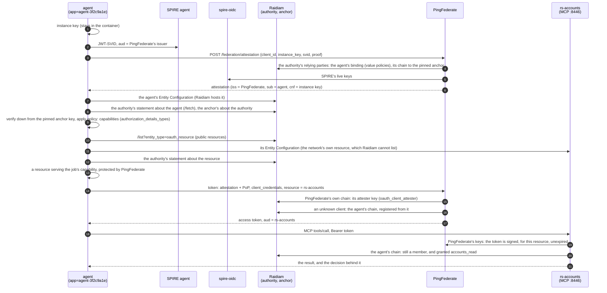

# The raidiam profile: PingFederate in Raidiam's federation, with SPIFFE client attestation

`PF_PROFILE=raidiam ./up.sh` runs the rig as an OpenID Provider in Raidiam's CBA federation, with client
attestation switched on. [`../spire-workload`](../spire-workload) then gets a token from it in three ways:

| `AUTH_MODE` | The workload authenticates with | Who builds the trust chain | Client in PingFederate |
|---|---|---|---|
| `attestation` | `attest_jwt_client_auth`: a JWT-SVID from its SPIRE agent, exchanged at PingFederate's attester for a client attestation | none: no federation | `spire-workload`, authored by [`../terraform/attestation.tf`](../terraform/attestation.tf) |
| `federation` | `private_key_jwt` with its trust chain in the assertion's `trust_chain` header | **the workload**, from Raidiam's fetch endpoints | registered automatically at the token endpoint (OpenID Federation 1.0 §12.1) |
| `federation-discovery` | its Entity Configuration alone at `/federation/register`, then `private_key_jwt` with no chain | **PingFederate**, following `authority_hints` to Raidiam's authority and anchor | registered explicitly (§12.2) |

Why the third one registers explicitly: 0.7.0's token endpoint registers a client it has never seen only from a
chain it is handed (`RegistrationService$TokenChannel.discoversUnknownClients()` is `false`). The authorization
and PAR endpoints and `/federation/register` resolve one themselves. Once registered, the token endpoint
renews an automatic registration by discovery; an explicit one ends with its chain (a day at most), and the
workload registers again on its next run. An attested request is the exception: with
`OIDF_ATTESTATION_AUTO_REGISTRATION=true`, which `up.sh` sets for this profile, the token endpoint registers a client it
does not have by discovery once its attestation verifies - how the agents are registered (below). A request that is not
authenticated still discovers nothing.

Everything here is **development only**: the production profile refuses inline keys
(`OIDF_BRIDGE_SIGNER_BACKING=config`, `attestation_signing_jwk`, `OIDF_ATTESTER_SIGNING_JWK`). The rig no longer uses
the mock attester (`oidf.mock.attesters`): the one attester the token endpoint trusts, PingFederate's own, is trusted
through its federation chain ("Attesters trusted through the federation", below). There is no agent provider: Raidiam
hosts the Principal agents' Entity Configurations, and the sub-agents serve their own.

## What it adds to the rig

| File | What |
|---|---|
| [`../vars.raidiam.env`](../vars.raidiam.env) | Federation and automatic registration on, Raidiam's anchor pinned, attestation on with the bridge keys |
| [`../docker-compose.raidiam.yml`](../docker-compose.raidiam.yml) | Mounts the bridge keys and the trust store |
| [`../terraform/attestation.tf`](../terraform/attestation.tf) | The `spire-workload` attestation client, authored only with `SPIRE_BUNDLE_FILE` |
| [`gen-keys.sh`](gen-keys.sh) | PingFederate's attester signing key and the client's bridge key (EC P-256), in `keys/raidiam/` |
| [`import-spire-bundle.sh`](import-spire-bundle.sh) | The JWT-SVID keys of a SPIRE bundle, for `attestation_spiffe_bundle` |
| [`render-runtime-keys.sh`](render-runtime-keys.sh) | The mounted files - the bridge keys, with the attesters each client accepts, and the trust store - for the issuer |

All key material is in `keys/raidiam/`, git-ignored like the rest of `keys/`.

## Running it

**1. Raidiam.** The rig names one federation: the CBA trust anchor and authority in `vars.raidiam.env` and
`../spire-workload/docker-compose.yml`. For the federation flows you need, under that authority:

- an authorisation server whose `Issuer` is `PF_BASE_URL`. Raidiam validates the issuer by fetching its
  discovery document, so it must be reachable from the internet while you save the record (ngrok, say);
- a software statement whose `ClientId` is the workload's Entity Identifier (`ENTITY_ID`, by default
  `https://localhost/agent/my-workload`). The `ClientId` can't be changed afterwards. Its `rtssigning` key must be
  the workload's entity key, certified through a CSR:
  `docker compose run --rm workload python workload.py csr "/C=GB/O=<framework org>/OU=<org id>/CN=<software statement id>"`
  with the key in `../spire-workload/keys/entity.jwk`.

**2. SPIRE.** A SPIRE server and agent, a registration entry for the workload
(`docker:label:app:my-workload` → `spiffe://example.org/my-workload`), and the server's trust bundle:

```sh
docker exec <spire-server> /opt/spire/bin/spire-server bundle show -format spiffe > spire-bundle.json
```

**3. The rig.**

```sh
PF_PROFILE=raidiam SPIRE_BUNDLE_FILE=$PWD/spire-bundle.json \
PF_BASE_URL=https://<your public issuer> ./up.sh
```

`PF_RIG_NAME`, `PF_PORT_*` and `PF_AUTHOR_*_PORT` run it beside another rig, as for any profile.

**4. The workload**, from `../spire-workload` (`PF_PORT_HTTPS` if the rig isn't on 9031):

```sh
docker compose run --rm workload                                    # attestation
docker compose run --rm -e AUTH_MODE=federation workload            # chain in the assertion
docker compose run --rm -e AUTH_MODE=federation-discovery workload  # PingFederate resolves the chain
```

The two federation flows register the same client id and run in either order while its registration is current:
each one's registration replaces the other's. A registration ends with its chain - with Raidiam's statements,
about twenty minutes. An expired *automatic* registration renews at the token endpoint; an expired *explicit*
one (from `federation-discovery`) does not, so `federation` is refused with `invalid_client` ("the client's
explicit registration has expired") until `federation-discovery` registers it again.

PingFederate binds a JWT-SVID to the first instance key that presents it. The SPIRE agent hands back the same SVID
until it nears expiry (its JWT-SVID TTL, five minutes by default), so a second attestation run inside that window
is refused with `instance_attestation_bound` - replay protection, not a fault. Run it again once SPIRE has
issued a fresh SVID.

### What the workload works around

`client-attestation-sdk` (1.1.0 and 1.2.0) predates two 0.6.0 changes in PingFederate's attester, and
`workload.py` adjusts for both:

- the attester's challenge endpoint (`/federation/attestation/challenge`) takes GET, and the SDK POSTs to it.
  The attester requires no challenge unless its document says `challenge_required`, so the workload drops
  the advertised endpoint then, and mints without one;
- the instance-key proof must carry `exp` as well as `iat`; the workload signs it with both.

## Attestation from a federation entity

In the `attestation` flow above, the attester knows which SPIFFE IDs belong to `spire-workload` because
PingFederate holds that client, with its `attestation_*` properties. For the agents, **Raidiam publishes it
instead**: each agent's software statement carries its SPIFFE binding, which Raidiam's authority publishes and
vouches for. PingFederate learns the agent and its instances through the federation, holds nothing of the agent's
except the name of its bridge key, and registers the agent itself at its first attested token request.

```mermaid
sequenceDiagram
    participant W as agent<br/>(app=agent-3f2c9a1e)
    participant S as SPIRE agent
    participant AT as PF attester
    participant O as spire-oidc
    participant AS as PF token endpoint
    participant R as Raidiam authority + anchor
    AT->>R: the authority's relying parties, each chain validated to the pinned anchor
    AT->>AT: value policies: spiffe_id, spiffe_bundle_endpoint, client_attesters = PingFederate
    W->>S: JWT-SVID spiffe://example.org/agent-3f2c9a1e
    W->>AT: POST /federation/attestation (SVID, instance key, proof)
    AT->>O: SPIRE's live keys
    AT-->>W: attestation (sub = the agent)
    W->>AS: token: attestation + PoP
    AS->>R: unknown client: its Entity Configuration (Raidiam hosts it), chain, policy
    AS->>AS: registered; bridge private_key_jwt with the agent's bridge key
    AS-->>W: access token, client_id = the agent's Raidiam identifier
```

| Piece | What |
|---|---|
| The agent's Raidiam software statement | Federation-managed (`openid_entity_federation_managed`): Raidiam hosts and signs its Entity Configuration at `https://rp.directory.cba.raidiam.io/openid_relying_party/<statement id>`, with `client_registration_types` `automatic` and a `jwks_uri` pointing at Raidiam's keystore of the certificates it issued. One `rtssigning` key, the **bridge key**, created in OpenBao. Its `AdditionalSoftwareMetadata` holds the binding - `spiffe_id`, `spiffe_trust_domain`, `spiffe_bundle_endpoint`, `client_attesters` (PingFederate's issuer) - which the authority publishes as value policies on `openid_relying_party`. The marketplace makes all of it ("The control centre", below) |
| `up.sh` with `PF_PROFILE=raidiam` | `OIDF_ATTESTER_FEDERATION_AUTHORITY` (the authority in `vars.raidiam.env`) and `OIDF_ATTESTER_ISSUER` (`PF_BASE_URL`): the attester's clients come from Raidiam (resolver `openid-federation-authority`). `OIDF_ATTESTATION_AUTO_REGISTRATION=true`: the token endpoint registers an agent once its attestation verifies. `OIDF_FETCH_HOST_ALLOWLIST=host.docker.internal`, for the sub-agents' configurations and SPIRE's keys |
| The bridge-keys file (`OIDF_BRIDGE_SIGNING_KEYS`) | With `RAIDIAM_BRIDGE_BACKING=vault`: a `"*"` template, `client_id_prefix` `https://rp.directory.cba.raidiam.io/openid_relying_party/` and `key_ref` `bridge-{client_suffix}`, and an entry per sub-agent (`bridge-accounts-agent`, `bridge-payments-agent`). The bridge assertion's `kid` is the one the client's registered keys (Raidiam's `jwks_uri`) give the bridge key, matched on the key: Raidiam names keys its own way |
| `spire-workload`'s `spire-oidc` service | SPIRE's OIDC Discovery Provider: the trust domain's **current** JWT-SVID keys at `https://host.docker.internal:8445/keys`, read through the agent's Workload API. The bindings name it as `spiffe_bundle_endpoint`, so the attester verifies each SVID against what SPIRE holds now (fetched at issuance, cached 300 s) - SPIRE's rotations reach it, and with SPIRE's keys unreachable it issues nothing. Its certificate is from the rig's CA, in `keys/raidiam/spire-oidc/` |
| The trust store | `raidiam/render-runtime-keys.sh` builds the image's own CAs plus the rig's into `truststore.p12`, mounted over the JDK's `cacerts`: the modules' fetches use the JVM's default SSL context, so this is what lets PingFederate check the sub-agents' and SPIRE's certificates - and Raidiam's - rather than skipping the checks |
| SPIRE | An entry per Principal version, `spiffe://example.org/agent-<first 8 characters of its statement id>` ← `docker:label:app:` the same label (the marketplace makes it); the sub-agents' `spiffe://example.org/<name>`; and `spiffe://example.org/spire-oidc` ← `docker:label:app:spire-oidc` |

This section used to set up a federated client of its own: `spire-client`
(`https://host.docker.internal:8443/agent/spire-client`, keys from `raidiam/attested-client.sh`), whose Entity
Configuration and `spiffe_client_bindings` the agent provider (`entity-host`) served and registered, run as
`attested-workload`. The provider is gone and nothing serves that configuration now, so that flow no longer works. The
Principal versions the marketplace deploys take its place.

What it takes, learned the hard way:

- **One client per SPIFFE ID.** An identity two clients bind is refused at issuance (`instance identity is bound
  to more than one client`). `spire-workload` binds `spiffe://example.org/my-workload` only, and each agent its own.
- **A source that fails is skipped silently.** The attester asks its client sources in turn (Raidiam's authority,
  then PingFederate's clients) and drops one that throws, so an authority it cannot read looks like
  "evidence identity is not registered with any client", or a mint for some other client. Its reason is at DEBUG
  (`com.pingidentity.ps.oidf.federation.TrustChainValidator`).
- **Federation and JWKS fetches trust the JDK's `cacerts` file - nothing else.** Not PingFederate's trusted CAs,
  and not `-Djavax.net.ssl.trustStore`. Hence the trust store mounted over `cacerts`, which must be built as the JDK
  builds its own: unprotected (`keystore.pkcs12.certProtectionAlgorithm=NONE`, `macAlgorithm=NONE`), since the JVM
  reads it with no password and keytool's default encrypts the certificates - a store that then reads as holding
  none, and fails Raidiam's TLS too. Entities and an OIDC provider with publicly trusted certificates need none of
  this.
- **A remote bundle keeps only keys whose `use` is `sig` or absent.** SPIRE's own bundle endpoint marks its keys
  `jwt-svid` / `x509-svid`, so it can't be a `spiffe_bundle_endpoint`; its OIDC Discovery Provider can.
- **The attester reads the authority every 300 s**, and at most every 30 s when evidence matches no client, so an
  agent Raidiam starts vouching for is attested at once. A change to a binding reaches it within five minutes; a
  restart of PingFederate is immediate.
- **Every restart of PingFederate drops the registrations** (the rig rebuilds from its archive). Each agent is
  registered again at its next attested token request.

### Attesters trusted through the federation

PingFederate's own attester is the rig's only one. The token endpoint trusts it as it would any other - by resolving
the attestation's `iss` through its chain to the pinned anchor and taking the key from that entity's
`metadata.oauth_client_attester.jwks` (`FederationAttesterKeyResolver`). Nothing is trusted statically.

| Attester | `iss` | Signs with | Its key published in | The bindings it checks |
|---|---|---|---|---|
| **PingFederate's own** (`/federation/attestation`) | PingFederate's issuer | `keys/raidiam/attester-signing` (`OIDF_ATTESTER_SIGNING_JWK`) | PingFederate's Entity Configuration (`OIDF_FEDERATION_ATTESTER_JWKS`) - Raidiam vouches for PingFederate | Raidiam's statements about the agents (`OIDF_ATTESTER_FEDERATION_AUTHORITY`), through each agent's chain |

PingFederate's attester is therefore **federation-native**: any authorisation server in the federation, not only
PingFederate's token endpoint, can verify its attestations by resolving PingFederate's chain. And it holds nothing per
agent: which SPIFFE IDs are instances of which agent is Raidiam's value policy on the agent, which no entity can
override.

The rig had a second attester, the agent provider's (`entity-host`'s `/attest`, `ATTESTER=provider`), as CBA's
provider (`https://provider.demo.cba.raidiam.io`) has. It went with the provider (`../flows.md`, "Without an agent
provider").

PingFederate logs the token request as `verified attestation … attester=<iss>` after `Trust chain for <iss> resolved`;
with an attester publishing some other key, the token request is refused (`no usable key matches the token's key id`).

One behaviour to know: asked to attest a SPIFFE ID under a `client_id` that does not bind it, PingFederate's attester
(0.7.0) does not refuse - it attests the SVID as whichever client does bind it (`spiffe://example.org/my-workload` as
`spire-workload`). That client is the right one for the workload, so nothing is gained, but the agent checks the
attestation's `sub` is itself and refuses otherwise.

## The agent-r flow

CBA's agent-r (`node agent.mjs`) is handed only its agent's identifier and works the rest out from the federation:
its running copy is attested (here by PingFederate's attester; agent-r's by its provider), it reads its own
capabilities from the authority, finds a resource that serves
the job, gets a token with `attest_jwt_client_auth` and calls the resource's MCP tool. `spire-workload` runs the same
flow with every component in a container, inside a "protected network" Raidiam cannot reach - as the bank's would be.
The agent is a Principal version the marketplace deployed, which Raidiam hosts.



| Component | What |
|---|---|
| `agent` (`agent.py`) | agent-r's steps. Unlike agent-r it resolves chains itself (`fedresolve.py`): Raidiam's `/resolve` fetches the leaf, which it cannot reach in the protected network, but its `/fetch` - the authority's signed statement - needs nothing from the leaf. Trust is still Raidiam's: every statement is verified down from the pinned anchor key |
| PingFederate's attester | Attests a copy on its JWT-SVID, against the binding Raidiam's authority publishes for the agent and SPIRE's live keys, and signs with the key PingFederate's Entity Configuration publishes |
| `rs-accounts` (`rs_accounts.py`) | An MCP server (tools `list_accounts`, `get_balance`) and a federation entity: `oauth_resource` metadata naming PingFederate. It checks the token, then the caller's chain and its capability in Raidiam's policy, whatever the token says |
| PingFederate | Accepts an attestation through its attester's chain, and registers the agent from Raidiam at its first attested token request (`OIDF_ATTESTATION_AUTO_REGISTRATION`). `RAIDIAM_RESOURCE_ID` on `up.sh` (with authoring) adds a token manager for the resource (`terraform/resource.tf`): without one a request naming it is `invalid_target`; with it the token's `aud` is the resource |
| Raidiam | Two statements: the agent's, federation-managed - Raidiam hosts its Entity Configuration, and its one key is the bridge key in OpenBao - and the resource's, self-managed, with its entity key. The resource is also an ApiResource on PingFederate's authorisation server record, under an API family of its own (a CBA family's schema pins its own issuer), with `resource` byte-identical to the resource's `ClientId`: Raidiam joins them by that identifier. The agent's capabilities (`authorization_details_types`) come from its **agentic roles** (authority claims, domain `CBA-Global`), not from fields on the statement: `cba.agentic.member` plus a capability role - `cba.agentic.servicing.assistant` grants `accounts_read` and `openid_credential`. `cba.accounts.reader` alone grants none; it only adds a trust mark. The agent refuses a job outside its capabilities before building a request, and the resource refuses the call |

```sh
raidiam/resource.sh keys && raidiam/resource.sh csr <resource's software statement id>   # upload as rtssigning
export RAIDIAM_RESOURCE_ID=https://host.docker.internal:8446
PF_PROFILE=raidiam SPIRE_BUNDLE_FILE=… RAIDIAM_BRIDGE_BACKING=vault ./up.sh
cd spire-workload && docker compose up -d spire-oidc rs-accounts
# a Principal version the marketplace deployed: its entity id, and its workload label (the deploy record's slot)
ATTESTED_CLIENT_ID=<its entity id> docker compose run --rm -l app=<its workload> agent list-accounts   # or get-balance
```

`python harness.py` tests the newest Principal version the marketplace deployed, end to end, and checks every step,
with the negatives (another workload refused attestation as the agent, a job outside the envelope refused, a call with
no token refused); its `attesters` stage checks why PingFederate trusted the attestation and the agent: its attester's
key, Raidiam vouching for PingFederate, the agent's binding in Raidiam, the attester reading the bindings from there,
and PingFederate having registered the agent on its verified attestation. `--agent <entity id> --label <workload>`
tests another version; `--report` writes the result as JSON.

PingFederate registers the agent itself, so nothing needs restarting after a restart of PingFederate.

## The control centre: the marketplace deploys Principal versions

The agent marketplace (`../marketplace`, in the rig's compose: http://localhost:3000) is the Agent registry and the
demo's control centre. Approving a **Principal version** there deploys it for real, against Raidiam's admin API and
OpenBao, with no agent provider:

| Step | What |
|---|---|
| statement | `POST /organisations/CBA-123/softwarestatements`: a federation-managed OpenID Federation entity (`OpenidFederationEntityManagementType` `openid_entity_federation_managed`), related to PingFederate. Raidiam gives it its identifier, `https://rp.directory.cba.raidiam.io/openid_relying_party/<statement id>`, and hosts and signs its Entity Configuration there |
| SPIFFE binding | `PUT` the statement with `AdditionalSoftwareMetadata`: `spiffe_id` `spiffe://example.org/agent-<first 8 characters of the statement id>`, `spiffe_trust_domain`, `spiffe_bundle_endpoint`, `client_attesters` (PingFederate's issuer). Raidiam keeps at most 255 characters, counted on its own re-serialisation, so `spiffe_bundle_format` is left out |
| bridge key | the marketplace creates `bridge-<statement id>` in OpenBao (rsa-2048, not exportable) with its enrolment token; the vault makes its CSR (`C=GB, O=CBA Trust Framework, OU=CBA-123, CN=<statement>`) and signs it. The private key never leaves OpenBao |
| certificate | `POST .../certificates/rtssigning` certifies the bridge CSR. A Principal has no entity key: Raidiam signs its Entity Configuration |
| roles | `POST .../authorityclaims` per role, from the organisation's own claims (`GET /organisations/CBA-123/authorityclaims`): `{OrganisationAuthorisationDomainRoleClaimID, AuthorisationDomain, Role, Status}` |
| verify | the statement, its certificates and its roles read back |
| SPIRE | an entry `spiffe://example.org/agent-<8>` <- `docker:label:app:agent-<8>`; the deploy record's `slot` holds this workload label |
| trust | the deploy waits until Raidiam serves its Entity Configuration and vouches for it, publishing the bridge key. PingFederate registers it at its first attested token request; nobody registers it beforehand |

Suspend sets the statement `Suspended` in Raidiam (the authority's `/fetch` then answers 404 for it) and raises
`account-disabled` at PingFederate's transmitter; reinstate reverses both.
Each version's page runs the scenarios - acts as itself, agents act on its behalf, over the policy limit, outside its
envelope, another workload, while suspended - each judged against what should happen; the
**Objectives** page lists TC-01..28 with the evidence from deploys, lifecycle actions, scenario runs and the
harness's last report (`spire-workload/reports/latest.json`).

The provider-hosted versions the rig deployed before (`https://host.docker.internal:8443/agent/principal-1` .. `-3`)
are suspended in Raidiam, and replaced by Raidiam-hosted versions (Principal Agent 1.0.0, 2.0.0 and 3.0.0).

**Signing in.** Raidiam allows `directory:management` only to a person's session for now, so the marketplace signs an
operator in: PAR with a signed request object, PKCE, JARM, `private_key_jwt` with the directory client's `rtssigning`
key over mutual TLS with its `rtstransport` certificate (`keys/raidiam/directory-client/`), scope `directory:website`.
The client's redirect URI is `https://localhost:8443/cb`; the agents' gateway (Kong, 8443, `gateway-agents`) routes
`/cb` to the marketplace. The session, with its refresh token, is kept in the marketplace's Mongo. When Raidiam allows
`directory:management` for client credentials: `RAIDIAM_GRANT=client_credentials`, nothing else.

**OpenBao.** Principal versions need it (`RAIDIAM_BRIDGE_BACKING=vault`): they have no key files. The bridge keys live in
OpenBao's transit engine, never exported, and the bridge-key file names them by convention: a `"*"` entry,
`bridge-{client_suffix}` for every client under `https://rp.directory.cba.raidiam.io/openid_relying_party/`, and an
entry per sub-agent. A deploy creates `bridge-<statement id>` in OpenBao and has OpenBao make its CSR, and PingFederate
finds the key by name with no restart, so there is no limit. This needs the module change on branch
`feature/bridge-keys-openbao` of the module source (`pf-agentic-identity1`; built jars staged in `image/modules`,
recorded in its `MANIFEST`): the template in `BridgeSigners` and RSA keys in `OpenBaoTransitSigner`.

Without OpenBao, PingFederate reads its bridge-key file once, at start-up, and `render-runtime-keys.sh` still renders the
pre-made slots (`RAIDIAM_PRINCIPAL_SLOTS`, default `principal-1` .. `principal-4`) - but those served the
provider-hosted versions, and the marketplace no longer deploys into them.

```sh
cd spire-workload && docker compose up -d openbao && python3 ../openbao/setup.py   # init, unseal, transit, policies, import
RAIDIAM_BRIDGE_BACKING=vault ... ./up.sh                                          # PingFederate signs bridge assertions in OpenBao
docker compose up -d marketplace                                                  # the marketplace enrols agents there
```

`openbao/setup.py` imports the bridge keys already in use (`bridge-spire-workload`, `bridge-spire-client`,
`bridge-accounts-agent`, `bridge-payments-agent`, each provider-hosted version's), so Raidiam's certificates stay valid.
Its two tokens:
- **PingFederate's** (`pf-bridge.token`) may read and sign with `bridge-*` keys only.
- **The enrolment token** (`enrolment/enrolment.token`, mounted into the marketplace only) may create `bridge-*` keys
  and their CSRs. It cannot sign with them, export, back up or delete them. OpenBao counts creating a key as an
  update, so it can change a key's settings (e.g. rotate it), which could disrupt an agent but never impersonate one.

Raidiam's admin API, as found:

- **`Accept`.** The certificate upload answers `403 {"errors":["Forbidden"]}` to `Accept: application/json`; send
  `*/*`.
- **`Environment`** is required on `PUT .../softwarestatements/{id}`, though not on create.
- **Status** is `Active` or `Suspended`; `Inactive` fails the update schema. A suspended statement cannot be re-sent
  with the same status (400).
- **The RTS client** behind a new statement is created asynchronously (`RtsClientCreated`).

## In a protected environment

Everything privately hosted, able to call Raidiam but not be called by it: what works, what does not, and what to fix
for production - [PROTECTED-ENVIRONMENTS.md](PROTECTED-ENVIRONMENTS.md).

## On Windows (Git Bash)

- **Terraform's plugin handshake.** Antivirus that intercepts TLS on loopback (Avast, for one) breaks Terraform's
  mTLS to its own provider: `Failed to load plugin schemas ... x509: certificate signed by unknown authority`.
  `export TF_DISABLE_PLUGIN_TLS=1` before `./up.sh`.
- **`COMPOSE_FILE`.** Docker on Windows splits it on `;`. `up.sh` sets `COMPOSE_PATH_SEPARATOR=:` for this profile;
  set it yourself for `docker-compose.rar-plugin.yml`.
- `gen-keys.sh` and `export.sh` work around Git Bash's path rewriting and `unzip`'s globbing themselves.
