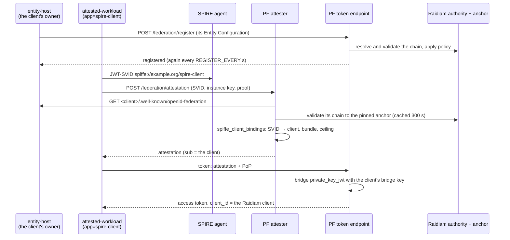

# The raidiam profile: PingFederate in Raidiam's federation, with SPIFFE client attestation

`PF_PROFILE=raidiam ./up.sh` runs the rig as an OpenID Provider in Raidiam's CBA federation, with client
attestation switched on. [`../spire-workload`](../spire-workload) then gets a token from it in three ways:

| `AUTH_MODE` | The workload authenticates with | Who builds the trust chain | Client in PingFederate |
|---|---|---|---|
| `attestation` | `attest_jwt_client_auth`: a JWT-SVID from its SPIRE agent, exchanged at PingFederate's attester for a client attestation | none: no federation | `spire-workload`, authored by [`../terraform/attestation.tf`](../terraform/attestation.tf) |
| `federation` | `private_key_jwt` with its trust chain in the assertion's `trust_chain` header | **the workload**, from Raidiam's fetch endpoints | registered automatically at the token endpoint (OpenID Federation 1.0 §12.1) |
| `federation-discovery` | its Entity Configuration alone at `/federation/register`, then `private_key_jwt` with no chain | **PingFederate**, following `authority_hints` to Raidiam's authority and anchor | registered explicitly (§12.2) |

Why the third one registers explicitly: 0.7.0's token endpoint registers a client it has never seen only from a
chain it is handed (`RegistrationService$TokenChannel.discoversUnknownClients()` is `false`). The authorization
and PAR endpoints and `/federation/register` resolve one themselves. Once registered, the token endpoint
renews an automatic registration by discovery; an explicit one ends with its chain (a day at most), and the
workload registers again on its next run.

Everything here is **development only**. The production profile refuses the mock attester (`oidf.mock.attesters`)
and inline keys (`OIDF_BRIDGE_SIGNER_BACKING=config`, `attestation_signing_jwk`).

## What it adds to the rig

| File | What |
|---|---|
| [`../vars.raidiam.env`](../vars.raidiam.env) | Federation and automatic registration on, Raidiam's anchor pinned, attestation on with the bridge keys |
| [`../docker-compose.raidiam.yml`](../docker-compose.raidiam.yml) | Mounts the trusted attester's key and the bridge keys; sets `oidf.mock.attesters` through `JAVA_OPTS` |
| [`../terraform/attestation.tf`](../terraform/attestation.tf) | The `spire-workload` attestation client, authored only with `SPIRE_BUNDLE_FILE` |
| [`gen-keys.sh`](gen-keys.sh) | The attester's signing key and the client's bridge key (EC P-256), in `keys/raidiam/` |
| [`import-spire-bundle.sh`](import-spire-bundle.sh) | The JWT-SVID keys of a SPIRE bundle, for `attestation_spiffe_bundle` |
| [`render-runtime-keys.sh`](render-runtime-keys.sh) | The two mounted files, for the issuer |

All key material is in `keys/raidiam/`, git-ignored like the rest of `keys/`.

## Running it

**1. Raidiam.** The rig names one federation: the CBA trust anchor and authority in `vars.raidiam.env` and
`../spire-workload/docker-compose.yml`. For the federation flows you need, under that authority:

- an authorisation server whose `Issuer` is `PF_BASE_URL`. Raidiam validates the issuer by fetching its
  discovery document, so it must be reachable from the internet while you save the record (ngrok, say);
- a software statement whose `ClientId` is the workload's Entity Identifier (`ENTITY_ID`, by default
  `https://localhost/agent/my-workload`). The `ClientId` can't be changed afterwards. Its `rtssigning` key must be
  the workload's entity key, certified through a CSR:
  `docker compose run --rm workload python workload.py csr "/C=GB/O=<framework org>/OU=<org id>/CN=<software statement id>"`
  with the key in `../spire-workload/keys/entity.jwk`.

**2. SPIRE.** A SPIRE server and agent, a registration entry for the workload
(`docker:label:app:my-workload` → `spiffe://example.org/my-workload`), and the server's trust bundle:

```sh
docker exec <spire-server> /opt/spire/bin/spire-server bundle show -format spiffe > spire-bundle.json
```

**3. The rig.**

```sh
PF_PROFILE=raidiam SPIRE_BUNDLE_FILE=$PWD/spire-bundle.json \
PF_BASE_URL=https://<your public issuer> ./up.sh
```

`PF_RIG_NAME`, `PF_PORT_*` and `PF_AUTHOR_*_PORT` run it beside another rig, as for any profile.

**4. The workload**, from `../spire-workload` (`PF_PORT_HTTPS` if the rig isn't on 9031):

```sh
docker compose run --rm workload                                    # attestation
docker compose run --rm -e AUTH_MODE=federation workload            # chain in the assertion
docker compose run --rm -e AUTH_MODE=federation-discovery workload  # PingFederate resolves the chain
```

The two federation flows register the same client id and run in either order while its registration is current:
each one's registration replaces the other's. A registration ends with its chain - with Raidiam's statements,
about twenty minutes. An expired *automatic* registration renews at the token endpoint; an expired *explicit*
one (from `federation-discovery`) does not, so `federation` is refused with `invalid_client` ("the client's
explicit registration has expired") until `federation-discovery` registers it again.

PingFederate binds a JWT-SVID to the first instance key that presents it. The SPIRE agent hands back the same SVID
until it nears expiry (its JWT-SVID TTL, five minutes by default), so a second attestation run inside that window
is refused with `instance_attestation_bound` - replay protection, not a fault. Run it again once SPIRE has
issued a fresh SVID.

### What the workload works around

`client-attestation-sdk` (1.1.0 and 1.2.0) predates two 0.6.0 changes in PingFederate's attester, and
`workload.py` adjusts for both:

- the attester's challenge endpoint (`/federation/attestation/challenge`) takes GET, and the SDK POSTs to it.
  The attester requires no challenge unless its document says `challenge_required`, so the workload drops
  the advertised endpoint then, and mints without one;
- the instance-key proof must carry `exp` as well as `iat`; the workload signs it with both.

## Attestation from a federation entity

In the `attestation` flow above, the attester knows which SPIFFE IDs belong to `spire-workload` because
PingFederate holds that client, with its `attestation_*` properties. Here the **client's owner publishes it
instead**, in its own Entity Configuration, and Raidiam vouches for that entity. PingFederate learns the client,
its instances and their ceiling through the federation, and holds nothing of the client's except a bridge key.



| Piece | What |
|---|---|
| The Raidiam software statement | `ClientId` = the entity's URL (by default `https://host.docker.internal:8443/agent/spire-client`), two `rtssigning` keys: the client's **entity key** and its **bridge key** |
| `raidiam/attested-client.sh keys` / `csr <ssid>` | Both keys and the entity host's TLS certificate, in `keys/raidiam/attested-client/`; then a CSR for each |
| `spire-workload`'s `entity-host` service | Serves the Entity Configuration, signed with the entity key: the bridge key as the client's only key, and `spiffe_client_bindings` (`client_id`, `spiffe_id`, `issuer`, `evidence_type`, `trust_domain`, `bundle_url`, `entitlement`, `ttl`). It registers the client explicitly, and again before each registration ends |
| `RAIDIAM_ATTESTED_CLIENT_ID=<entity URL>` on `up.sh` | `OIDF_ATTESTER_FEDERATION_ENTITY`, `OIDF_ATTESTER_SIGNING_JWK`, the entity host's host in `OIDF_FETCH_HOST_ALLOWLIST`, the client's bridge key in `OIDF_BRIDGE_SIGNING_KEYS` |
| `spire-workload`'s `spire-oidc` service | SPIRE's OIDC Discovery Provider: the trust domain's **current** JWT-SVID keys at `https://host.docker.internal:8445/keys`, read through the agent's Workload API. The bindings name it as `bundle_url`, so the attester verifies each SVID against what SPIRE holds now (fetched at issuance, cached 300 s) - SPIRE's rotations reach it, and with SPIRE's keys unreachable it issues nothing. Its certificate is from the rig's CA, in `keys/raidiam/spire-oidc/` |
| The trust store | `raidiam/render-runtime-keys.sh` builds the image's own CAs plus the rig's into `truststore.p12`, mounted over the JDK's `cacerts`: the modules' fetches use the JVM's default SSL context, so this is what lets PingFederate check the entity host's and SPIRE's certificates - and Raidiam's - rather than skipping the checks |
| SPIRE | Entries `spiffe://example.org/spire-client` ← `docker:label:app:spire-client` (`attested-workload` runs with that label) and `spiffe://example.org/spire-oidc` ← `docker:label:app:spire-oidc` (the provider) |

```sh
raidiam/attested-client.sh keys
raidiam/attested-client.sh csr <software statement id>     # upload both CSRs as rtssigning keys
PF_PROFILE=raidiam SPIRE_BUNDLE_FILE=… RAIDIAM_ATTESTED_CLIENT_ID=https://host.docker.internal:8443/agent/spire-client ./up.sh
cd spire-workload && docker compose up -d spire-oidc entity-host && docker compose run --rm attested-workload
```

What it takes, learned the hard way:

- **One client per SPIFFE ID.** An identity two clients bind is refused at issuance (`instance identity is bound
  to more than one client`). `spire-workload` binds `spiffe://example.org/my-workload` only, and the federated client
  `spiffe://example.org/spire-client`.
- **A source that fails is skipped silently.** The attester asks its client sources in turn (the federation
  entity, then PingFederate's clients) and drops one that throws, so a federation entity it cannot fetch looks like
  "evidence identity is not registered with any client", or a mint for some other client. Its reason is at DEBUG
  (`com.pingidentity.ps.oidf.federation.TrustChainValidator`).
- **Federation and JWKS fetches trust the JDK's `cacerts` file - nothing else.** Not PingFederate's trusted CAs,
  and not `-Djavax.net.ssl.trustStore`. Hence the trust store mounted over `cacerts`, which must be built as the JDK
  builds its own: unprotected (`keystore.pkcs12.certProtectionAlgorithm=NONE`, `macAlgorithm=NONE`), since the JVM
  reads it with no password and keytool's default encrypts the certificates - a store that then reads as holding
  none, and fails Raidiam's TLS too. A real entity host and OIDC provider have publicly trusted certificates and
  need none of this.
- **A remote bundle keeps only keys whose `use` is `sig` or absent.** SPIRE's own bundle endpoint marks its keys
  `jwt-svid` / `x509-svid`, so it can't be a `bundle_url`; its OIDC Discovery Provider can.
- **The attester caches the entity for 300 s.** A change to the bindings reaches it within five minutes; a
  restart of PingFederate is immediate.
- **Every restart of PingFederate drops the registration** (the rig rebuilds from its archive); `docker compose
  restart entity-host` registers it at once rather than at its next interval.

## On Windows (Git Bash)

- **Terraform's plugin handshake.** Antivirus that intercepts TLS on loopback (Avast, for one) breaks Terraform's
  mTLS to its own provider: `Failed to load plugin schemas ... x509: certificate signed by unknown authority`.
  `export TF_DISABLE_PLUGIN_TLS=1` before `./up.sh`.
- **`COMPOSE_FILE`.** Docker on Windows splits it on `;`. `up.sh` sets `COMPOSE_PATH_SEPARATOR=:` for this profile;
  set it yourself for `docker-compose.rar-plugin.yml`.
- `gen-keys.sh` and `export.sh` work around Git Bash's path rewriting and `unzip`'s globbing themselves.
