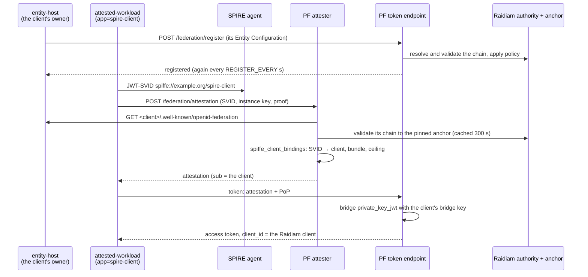
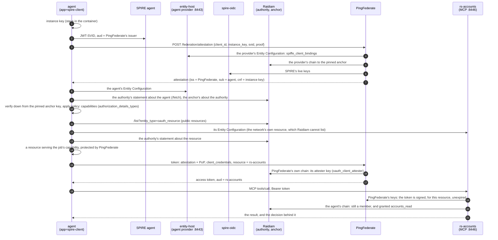

# The raidiam profile: PingFederate in Raidiam's federation, with SPIFFE client attestation

`PF_PROFILE=raidiam ./up.sh` runs the rig as an OpenID Provider in Raidiam's CBA federation, with client
attestation switched on. [`../spire-workload`](../spire-workload) then gets a token from it in three ways:

| `AUTH_MODE` | The workload authenticates with | Who builds the trust chain | Client in PingFederate |
|---|---|---|---|
| `attestation` | `attest_jwt_client_auth`: a JWT-SVID from its SPIRE agent, exchanged at PingFederate's attester for a client attestation | none: no federation | `spire-workload`, authored by [`../terraform/attestation.tf`](../terraform/attestation.tf) |
| `federation` | `private_key_jwt` with its trust chain in the assertion's `trust_chain` header | **the workload**, from Raidiam's fetch endpoints | registered automatically at the token endpoint (OpenID Federation 1.0 §12.1) |
| `federation-discovery` | its Entity Configuration alone at `/federation/register`, then `private_key_jwt` with no chain | **PingFederate**, following `authority_hints` to Raidiam's authority and anchor | registered explicitly (§12.2) |

Why the third one registers explicitly: 0.7.0's token endpoint registers a client it has never seen only from a
chain it is handed (`RegistrationService$TokenChannel.discoversUnknownClients()` is `false`). The authorization
and PAR endpoints and `/federation/register` resolve one themselves. Once registered, the token endpoint
renews an automatic registration by discovery; an explicit one ends with its chain (a day at most), and the
workload registers again on its next run.

Everything here is **development only**: the production profile refuses inline keys
(`OIDF_BRIDGE_SIGNER_BACKING=config`, `attestation_signing_jwk`, `OIDF_ATTESTER_SIGNING_JWK`). The rig no longer uses
the mock attester (`oidf.mock.attesters`): every attester the token endpoint trusts - PingFederate's own and the agent
provider's - is trusted through its federation chain ("Attesters trusted through the federation", below).

## What it adds to the rig

| File | What |
|---|---|
| [`../vars.raidiam.env`](../vars.raidiam.env) | Federation and automatic registration on, Raidiam's anchor pinned, attestation on with the bridge keys |
| [`../docker-compose.raidiam.yml`](../docker-compose.raidiam.yml) | Mounts the bridge keys and the trust store |
| [`../terraform/attestation.tf`](../terraform/attestation.tf) | The `spire-workload` attestation client, authored only with `SPIRE_BUNDLE_FILE` |
| [`gen-keys.sh`](gen-keys.sh) | PingFederate's attester signing key and the client's bridge key (EC P-256), in `keys/raidiam/` |
| [`import-spire-bundle.sh`](import-spire-bundle.sh) | The JWT-SVID keys of a SPIRE bundle, for `attestation_spiffe_bundle` |
| [`render-runtime-keys.sh`](render-runtime-keys.sh) | The mounted files - the bridge keys, with the attesters each client accepts, and the trust store - for the issuer |

All key material is in `keys/raidiam/`, git-ignored like the rest of `keys/`.

## Running it

**1. Raidiam.** The rig names one federation: the CBA trust anchor and authority in `vars.raidiam.env` and
`../spire-workload/docker-compose.yml`. For the federation flows you need, under that authority:

- an authorisation server whose `Issuer` is `PF_BASE_URL`. Raidiam validates the issuer by fetching its
  discovery document, so it must be reachable from the internet while you save the record (ngrok, say);
- a software statement whose `ClientId` is the workload's Entity Identifier (`ENTITY_ID`, by default
  `https://localhost/agent/my-workload`). The `ClientId` can't be changed afterwards. Its `rtssigning` key must be
  the workload's entity key, certified through a CSR:
  `docker compose run --rm workload python workload.py csr "/C=GB/O=<framework org>/OU=<org id>/CN=<software statement id>"`
  with the key in `../spire-workload/keys/entity.jwk`.

**2. SPIRE.** A SPIRE server and agent, a registration entry for the workload
(`docker:label:app:my-workload` → `spiffe://example.org/my-workload`), and the server's trust bundle:

```sh
docker exec <spire-server> /opt/spire/bin/spire-server bundle show -format spiffe > spire-bundle.json
```

**3. The rig.**

```sh
PF_PROFILE=raidiam SPIRE_BUNDLE_FILE=$PWD/spire-bundle.json \
PF_BASE_URL=https://<your public issuer> ./up.sh
```

`PF_RIG_NAME`, `PF_PORT_*` and `PF_AUTHOR_*_PORT` run it beside another rig, as for any profile.

**4. The workload**, from `../spire-workload` (`PF_PORT_HTTPS` if the rig isn't on 9031):

```sh
docker compose run --rm workload                                    # attestation
docker compose run --rm -e AUTH_MODE=federation workload            # chain in the assertion
docker compose run --rm -e AUTH_MODE=federation-discovery workload  # PingFederate resolves the chain
```

The two federation flows register the same client id and run in either order while its registration is current:
each one's registration replaces the other's. A registration ends with its chain - with Raidiam's statements,
about twenty minutes. An expired *automatic* registration renews at the token endpoint; an expired *explicit*
one (from `federation-discovery`) does not, so `federation` is refused with `invalid_client` ("the client's
explicit registration has expired") until `federation-discovery` registers it again.

PingFederate binds a JWT-SVID to the first instance key that presents it. The SPIRE agent hands back the same SVID
until it nears expiry (its JWT-SVID TTL, five minutes by default), so a second attestation run inside that window
is refused with `instance_attestation_bound` - replay protection, not a fault. Run it again once SPIRE has
issued a fresh SVID.

### What the workload works around

`client-attestation-sdk` (1.1.0 and 1.2.0) predates two 0.6.0 changes in PingFederate's attester, and
`workload.py` adjusts for both:

- the attester's challenge endpoint (`/federation/attestation/challenge`) takes GET, and the SDK POSTs to it.
  The attester requires no challenge unless its document says `challenge_required`, so the workload drops
  the advertised endpoint then, and mints without one;
- the instance-key proof must carry `exp` as well as `iat`; the workload signs it with both.

## Attestation from a federation entity

In the `attestation` flow above, the attester knows which SPIFFE IDs belong to `spire-workload` because
PingFederate holds that client, with its `attestation_*` properties. Here the **client's owner publishes it
instead**, in its own Entity Configuration, and Raidiam vouches for that entity. PingFederate learns the client,
its instances and their ceiling through the federation, and holds nothing of the client's except a bridge key.



| Piece | What |
|---|---|
| The Raidiam software statement | `ClientId` = the entity's URL (by default `https://host.docker.internal:8443/agent/spire-client`), two `rtssigning` keys: the client's **entity key** and its **bridge key** |
| `raidiam/attested-client.sh keys` / `csr <ssid>` | Both keys and the entity host's TLS certificate, in `keys/raidiam/attested-client/`; then a CSR for each |
| `spire-workload`'s `entity-host` service | Serves the Entity Configuration, signed with the entity key: the bridge key as the client's only key, and `spiffe_client_bindings` (`client_id`, `spiffe_id`, `issuer`, `evidence_type`, `trust_domain`, `bundle_url`, `entitlement`, `ttl`). It registers the client explicitly, and again before each registration ends |
| `RAIDIAM_ATTESTED_CLIENT_ID=<entity URL>` on `up.sh` | `OIDF_ATTESTER_FEDERATION_ENTITY` (unless `RAIDIAM_PROVIDER_ID` names the provider, whose Entity Configuration binds all its agents), the entity host's host in `OIDF_FETCH_HOST_ALLOWLIST`, the client's bridge key in `OIDF_BRIDGE_SIGNING_KEYS` |
| `spire-workload`'s `spire-oidc` service | SPIRE's OIDC Discovery Provider: the trust domain's **current** JWT-SVID keys at `https://host.docker.internal:8445/keys`, read through the agent's Workload API. The bindings name it as `bundle_url`, so the attester verifies each SVID against what SPIRE holds now (fetched at issuance, cached 300 s) - SPIRE's rotations reach it, and with SPIRE's keys unreachable it issues nothing. Its certificate is from the rig's CA, in `keys/raidiam/spire-oidc/` |
| The trust store | `raidiam/render-runtime-keys.sh` builds the image's own CAs plus the rig's into `truststore.p12`, mounted over the JDK's `cacerts`: the modules' fetches use the JVM's default SSL context, so this is what lets PingFederate check the entity host's and SPIRE's certificates - and Raidiam's - rather than skipping the checks |
| SPIRE | Entries `spiffe://example.org/spire-client` ← `docker:label:app:spire-client` (`attested-workload` runs with that label) and `spiffe://example.org/spire-oidc` ← `docker:label:app:spire-oidc` (the provider) |

```sh
raidiam/attested-client.sh keys
raidiam/attested-client.sh csr <software statement id>     # upload both CSRs as rtssigning keys
PF_PROFILE=raidiam SPIRE_BUNDLE_FILE=… RAIDIAM_ATTESTED_CLIENT_ID=https://host.docker.internal:8443/agent/spire-client ./up.sh
cd spire-workload && docker compose up -d spire-oidc entity-host && docker compose run --rm attested-workload
```

What it takes, learned the hard way:

- **One client per SPIFFE ID.** An identity two clients bind is refused at issuance (`instance identity is bound
  to more than one client`). `spire-workload` binds `spiffe://example.org/my-workload` only, and the federated client
  `spiffe://example.org/spire-client`.
- **A source that fails is skipped silently.** The attester asks its client sources in turn (the federation
  entity, then PingFederate's clients) and drops one that throws, so a federation entity it cannot fetch looks like
  "evidence identity is not registered with any client", or a mint for some other client. Its reason is at DEBUG
  (`com.pingidentity.ps.oidf.federation.TrustChainValidator`).
- **Federation and JWKS fetches trust the JDK's `cacerts` file - nothing else.** Not PingFederate's trusted CAs,
  and not `-Djavax.net.ssl.trustStore`. Hence the trust store mounted over `cacerts`, which must be built as the JDK
  builds its own: unprotected (`keystore.pkcs12.certProtectionAlgorithm=NONE`, `macAlgorithm=NONE`), since the JVM
  reads it with no password and keytool's default encrypts the certificates - a store that then reads as holding
  none, and fails Raidiam's TLS too. A real entity host and OIDC provider have publicly trusted certificates and
  need none of this.
- **A remote bundle keeps only keys whose `use` is `sig` or absent.** SPIRE's own bundle endpoint marks its keys
  `jwt-svid` / `x509-svid`, so it can't be a `bundle_url`; its OIDC Discovery Provider can.
- **The attester caches the entity for 300 s.** A change to the bindings reaches it within five minutes; a
  restart of PingFederate is immediate.
- **Every restart of PingFederate drops the registration** (the rig rebuilds from its archive); `docker compose
  restart entity-host` registers it at once rather than at its next interval.

### Attesters trusted through the federation

Two attesters can vouch for an agent's running instances, and the token endpoint trusts each the same way - by
resolving the attestation's `iss` through its chain to the pinned anchor and taking the key from that entity's
`metadata.oauth_client_attester.jwks` (`FederationAttesterKeyResolver`). Nothing is trusted statically.

| Attester | `iss` | Signs with | Its key published in | The bindings it checks |
|---|---|---|---|---|
| **PingFederate's own** (`/federation/attestation`; the default, `ATTESTER=pingfederate`) | PingFederate's issuer | `keys/raidiam/attester-signing` (`OIDF_ATTESTER_SIGNING_JWK`) | PingFederate's Entity Configuration (`OIDF_FEDERATION_ATTESTER_JWKS`) - Raidiam vouches for PingFederate | the provider's Entity Configuration (`OIDF_ATTESTER_FEDERATION_ENTITY`), through the provider's chain |
| **The agent provider** (`entity-host`'s `/attest`, `ATTESTER=provider`) | the provider (`https://host.docker.internal:8443`) | `keys/raidiam/provider/attester` | the provider's Entity Configuration - Raidiam vouches for the provider | its own |

PingFederate's attester is therefore **federation-native**: any authorisation server in the federation, not only
PingFederate's token endpoint, can verify its attestations by resolving PingFederate's chain. And it holds nothing per
agent: which SPIFFE IDs are instances of which agent is the provider's published, Raidiam-vouched metadata.

The agent provider follows CBA's (`https://provider.demo.cba.raidiam.io`): a federation entity of its own, vouched for by
Raidiam, hosting the agents' Entity Configurations. Its Entity Configuration publishes

- its attester key, as `oauth_client_attester.jwks` and, as CBA's provider has it, `federation_entity.attestation_jwks`;
- `spiffe_client_bindings` for every agent it hosts, naming PingFederate as `issuer` - what PingFederate's attester reads;
- `/agents`, the agents it hosts.

Each agent's own Entity Configuration carries its bindings twice, once per attester (PingFederate's first: the attester
takes a client's first binding for a SPIFFE ID). Each client's bridge (`OIDF_BRIDGE_SIGNING_KEYS`) accepts both attesters.

| Piece | What |
|---|---|
| The provider's Raidiam software statement | Self-managed, `ClientId` = the entity host's root (`https://host.docker.internal:8443`), one `rtssigning` key: the provider's **entity key** |
| `raidiam/provider.sh keys` / `csr <ssid>` | The entity key and the provider's **attester key** (EC P-256), in `keys/raidiam/provider/`; then a CSR for the entity key |
| `RAIDIAM_PROVIDER_ID` on `up.sh` | `OIDF_ATTESTER_FEDERATION_ENTITY` = the provider; each client's bridge accepts PingFederate's attester and the provider |
| `up.sh` with `PF_PROFILE=raidiam` | `OIDF_ATTESTER_SIGNING_JWK` and `OIDF_FEDERATION_ATTESTER_JWKS` = PingFederate's own attester key, private and public |
| `attested-workload` | The SDK's flow at PingFederate's attester: a JWT-SVID addressed to PingFederate's issuer |

```sh
raidiam/provider.sh keys
raidiam/provider.sh csr <provider's software statement id>     # upload as an rtssigning key
export RAIDIAM_PROVIDER_ID=https://host.docker.internal:8443
PF_PROFILE=raidiam SPIRE_BUNDLE_FILE=… RAIDIAM_ATTESTED_CLIENT_ID=https://host.docker.internal:8443/agent/spire-client ./up.sh
cd spire-workload && docker compose up -d spire-oidc entity-host && docker compose run --rm attested-workload
docker compose run --rm agent get-balance                        # PingFederate's attester
ATTESTER=provider docker compose run --rm agent get-balance      # the provider's
```

PingFederate logs the token request as `verified attestation … attester=<iss>` after `Trust chain for <iss> resolved`;
with an attester publishing some other key, the token request is refused (`no usable key matches the token's key id`).

One behaviour to know: asked to attest a SPIFFE ID under a `client_id` that does not bind it, PingFederate's attester
(0.7.0) does not refuse - it attests the SVID as whichever client does bind it (`spiffe://example.org/my-workload` as
`spire-workload`). That client is the right one for the workload, so nothing is gained, but the agent checks the
attestation's `sub` is itself and refuses otherwise. Still the rig's: the agents are registered by `entity-host`
(0.7.0's token endpoint does not discover an unknown client).

## The agent-r flow

CBA's agent-r (`node agent.mjs`) is handed only its agent's identifier and works the rest out from the federation:
its running copy is attested (here by PingFederate's attester, or by its provider as agent-r's is), it reads its own
capabilities from the authority, finds a resource that serves
the job, gets a token with `attest_jwt_client_auth` and calls the resource's MCP tool. `spire-workload` runs the same
flow with every component in a container, inside a "protected network" Raidiam cannot reach - as the bank's would be.



| Component | What |
|---|---|
| `agent` (`agent.py`) | agent-r's steps. Unlike agent-r it resolves chains itself (`fedresolve.py`): Raidiam's `/resolve` fetches the leaf, which it cannot reach in the protected network, but its `/fetch` - the authority's signed statement - needs nothing from the leaf. Trust is still Raidiam's: every statement is verified down from the pinned anchor key |
| PingFederate's attester | Attests a copy on its JWT-SVID, against the bindings in the provider's Entity Configuration and SPIRE's live keys, and signs with the key PingFederate's Entity Configuration publishes (the default) |
| `entity-host` `/attest` | With `ATTESTER=provider`: the provider attests a copy itself, signing with its attester key (`keys/raidiam/provider/attester.*`), as CBA's provider does. It wants the copy's JWT-SVID as well, checked against SPIRE's live keys and the agent's bindings - CBA's provider attests whatever key it is sent |
| `rs-accounts` (`rs_accounts.py`) | An MCP server (tools `list_accounts`, `get_balance`) and a federation entity: `oauth_resource` metadata naming PingFederate. It checks the token, then the caller's chain and its capability in Raidiam's policy, whatever the token says |
| PingFederate | Accepts an attestation through its attester's chain - its own, or the provider's. `RAIDIAM_RESOURCE_ID` on `up.sh` (with authoring) adds a token manager for the resource (`terraform/resource.tf`): without one a request naming it is `invalid_target`; with it the token's `aud` is the resource |
| Raidiam | Three self-managed statements - the provider, the agent, the resource - each with its entity key. The resource is also an ApiResource on PingFederate's authorisation server record, under an API family of its own (a CBA family's schema pins its own issuer), with `resource` byte-identical to the resource's `ClientId`: Raidiam joins them by that identifier. The agent's capabilities (`authorization_details_types`) come from its **agentic roles** (authority claims, domain `CBA-Global`), not from fields on the statement: `cba.agentic.member` plus a capability role - `cba.agentic.servicing.assistant` grants `accounts_read` and `openid_credential`. `cba.accounts.reader` alone grants none; it only adds a trust mark. The agent refuses a job outside its capabilities before building a request, and the resource refuses the call |

```sh
raidiam/resource.sh keys && raidiam/resource.sh csr <resource's software statement id>   # upload as rtssigning
export RAIDIAM_PROVIDER_ID=https://host.docker.internal:8443 RAIDIAM_RESOURCE_ID=https://host.docker.internal:8446
PF_PROFILE=raidiam SPIRE_BUNDLE_FILE=… RAIDIAM_ATTESTED_CLIENT_ID=https://host.docker.internal:8443/agent/spire-client ./up.sh
cd spire-workload && docker compose up -d spire-oidc entity-host rs-accounts
docker compose run --rm agent list-accounts        # or get-balance
```

`python harness.py` runs the flow end to end and checks every step, with the negatives (another workload refused
attestation as the agent, a job outside the envelope refused, a call with no token refused); its `attesters` stage
checks why PingFederate trusted the attestation and runs the job with the other attester. `--attester provider`
makes the provider the Principal's attester; `--report` writes the result as JSON.

The registration is still `entity-host`'s (0.7.0's token endpoint does not discover an unknown client), so
`docker compose restart entity-host` after a restart of PingFederate.

## The control centre: the marketplace deploys Principal versions

The agent marketplace (`../marketplace`, in the rig's compose: http://localhost:3000) is the Agent registry and the
demo's control centre. Approving a **Principal version** there deploys it for real, against Raidiam's admin API:

| Step | What |
|---|---|
| slot | the provider claims a Principal slot, `https://host.docker.internal:8443/agent/principal-N` (`spire-workload/principals.py`) |
| statement | `POST /organisations/CBA-123/softwarestatements`: self-managed OpenID Federation entity, `ClientId` = the slot, related to PingFederate |
| certificates | the provider makes CSRs for its entity and bridge keys (`C=GB, O=CBA Trust Framework, OU=CBA-123, CN=<statement>`) - private keys stay with it - and `POST .../certificates/rtssigning` certifies each |
| roles | `POST .../authorityclaims` per role, from the organisation's own claims (`GET /organisations/CBA-123/authorityclaims`): `{OrganisationAuthorisationDomainRoleClaimID, AuthorisationDomain, Role, Status}` |
| host, SPIRE | the provider publishes its Entity Configuration; a SPIRE entry `spiffe://example.org/principal-N` <- `docker:label:app:principal-N` |
| trust | Raidiam vouches for its keys; the provider registers it at PingFederate at once |

Suspend sets the statement `Suspended` in Raidiam (the authority's `/fetch` then answers 404 for it), raises
`account-disabled` at PingFederate's transmitter and withdraws its Entity Configuration; reinstate reverses all three.
Each version's page runs the scenarios - acts as itself, agents act on its behalf, over the policy limit, outside its
envelope, another workload, attested by the provider, while suspended - each judged against what should happen; the
**Objectives** page lists TC-01..28 with the evidence from deploys, lifecycle actions, scenario runs and the
harness's last report (`spire-workload/reports/latest.json`).

**Signing in.** Raidiam allows `directory:management` only to a person's session for now, so the marketplace signs an
operator in: PAR with a signed request object, PKCE, JARM, `private_key_jwt` with the directory client's `rtssigning`
key over mutual TLS with its `rtstransport` certificate (`keys/raidiam/directory-client/`), scope `directory:website`.
The client's redirect URI is `https://localhost:8443/cb`; the provider's gateway (Kong, 8443) routes `/cb` to the
marketplace. The session, with its refresh token, is kept in the marketplace's Mongo. When Raidiam allows
`directory:management` for client credentials: `RAIDIAM_GRANT=client_credentials`, nothing else.

**Slots, or OpenBao.** PingFederate reads its bridge-key file once, at start-up. By default up.sh therefore makes the
slots' keys in advance (`PRINCIPAL=<slot> raidiam/attested-client.sh keys`, `RAIDIAM_PRINCIPAL_SLOTS`, default
`principal-1` .. `principal-4`), and a deploy takes a free one.

With **OpenBao** (`RAIDIAM_BRIDGE_BACKING=vault`) there is no limit. The bridge keys live in OpenBao's transit engine,
never exported, and the bridge-key file names them by convention: an entry under `"*"`, `bridge-{client_suffix}` for
every client under `<provider>/agent/`. A deploy enrols the next `principal-N`. The provider creates `bridge-<name>` in
OpenBao and has OpenBao make its CSR, and PingFederate finds the key by name with no restart. This needs the module change
on branch `feature/bridge-keys-openbao` of the module source (`pf-agentic-identity1`; built jars staged in
`image/modules`, recorded in its `MANIFEST`): the template in `BridgeSigners` and RSA keys in `OpenBaoTransitSigner`.

```sh
cd spire-workload && docker compose up -d openbao && python3 ../openbao/setup.py   # init, unseal, transit, policies, import
RAIDIAM_BRIDGE_BACKING=vault ... ./up.sh                                          # PingFederate signs bridge assertions in OpenBao
RAIDIAM_BRIDGE_BACKING=vault docker compose up -d entity-host                     # the provider enrols agents there
```

`openbao/setup.py` imports the bridge keys already in use (`bridge-spire-workload`, `bridge-spire-client`,
`bridge-accounts-agent`, `bridge-payments-agent`, each deployed version's), so Raidiam's certificates stay valid. Its two
tokens:
- **PingFederate's** may read and sign with `bridge-*` keys only.
- **The provider's** may create `bridge-*` keys and their CSRs. It cannot sign with them, export, back up or delete
  them. OpenBao counts creating a key as an update, so it can change a key's settings (e.g. rotate it), which could
  disrupt an agent but never impersonate one.

Raidiam's admin API, as found:

- **`Accept`.** The certificate upload answers `403 {"errors":["Forbidden"]}` to `Accept: application/json`; send
  `*/*`.
- **`Environment`** is required on `PUT .../softwarestatements/{id}`, though not on create.
- **Status** is `Active` or `Suspended`; `Inactive` fails the update schema. A suspended statement cannot be re-sent
  with the same status (400).
- **The RTS client** behind a new statement is created asynchronously (`RtsClientCreated`).

## In a protected environment

Everything privately hosted, able to call Raidiam but not be called by it: what works, what does not, and what to fix
for production - [PROTECTED-ENVIRONMENTS.md](PROTECTED-ENVIRONMENTS.md).

## On Windows (Git Bash)

- **Terraform's plugin handshake.** Antivirus that intercepts TLS on loopback (Avast, for one) breaks Terraform's
  mTLS to its own provider: `Failed to load plugin schemas ... x509: certificate signed by unknown authority`.
  `export TF_DISABLE_PLUGIN_TLS=1` before `./up.sh`.
- **`COMPOSE_FILE`.** Docker on Windows splits it on `;`. `up.sh` sets `COMPOSE_PATH_SEPARATOR=:` for this profile;
  set it yourself for `docker-compose.rar-plugin.yml`.
- `gen-keys.sh` and `export.sh` work around Git Bash's path rewriting and `unzip`'s globbing themselves.
